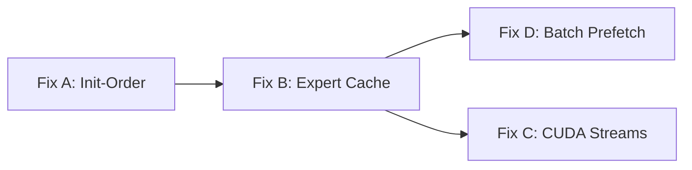

# MoE Streaming Performance: 4-Fix Implementation Plan

**Goal:** Reduce Vaayu's MoE decode latency from **15s/token → <1s/token** by fixing four compounding bottlenecks.

**Architecture:** Mixtral-8x7B (32 layers, 8 experts, top-2 routing)  
**Hardware:** 16 GB VRAM, 33 GB RAM, NVMe (~2.2–6.4 GB/s), PCIe Gen1 x8 (possibly misdetected)

---

## Fix A: Init-Order — Pin All 32 Layers' Non-Expert Weights

**Impact:** Eliminates `gpu_load` bottleneck → saves **~4.5s/token**  
**Complexity:** Trivial (reorder 5 lines)

### Problem

`_init_pinned_layers()` runs at [line 476](file:///home/a/code/ai-ml/Vaayu/vaayu/vaayu_base.py#L476) — **before** `_expert_offset_index` is built at [line 504](file:///home/a/code/ai-ml/Vaayu/vaayu/vaayu_base.py#L504). Phase 2 pinning checks `getattr(self, '_expert_offset_index', None) is not None`, which is `False`, so it loads full 2.9 GB layers instead of 80 MB non-expert only. Budget exhausts after 3 layers.

### Files

#### [MODIFY] [vaayu_base.py](file:///home/a/code/ai-ml/Vaayu/vaayu/vaayu_base.py)

- [ ] **Step 1: Move MoE offset index build before pinned layers**

  Move the `_expert_offset_index` initialization block (currently at lines 490–505) to run **before** `_init_pinned_layers()` (line 476). The block to move:

  ```python
  # MoE Expert-Aware Streaming: build offset index early so _init_pinned_layers
  # can use _load_non_expert_strategy (80 MB) instead of full layer load (2.9 GB).
  self._expert_history: dict[int, list[int]] = {}
  self._expert_cache = None
  self._expert_offset_index = None
  self._moe_blocks: list = []
  self._non_expert_tensor_cache: dict[str, dict] = {}
  if self.running_device.startswith("cuda") and self.is_moe:
      from .persist.expert_offset_index import ExpertOffsetIndex
      self._expert_offset_index = ExpertOffsetIndex(str(self.checkpoint_path))
      self._expert_offset_index.build_or_load()
  ```

  This must execute **before** `self._init_pinned_layers()`. The expert cache creation and MoE patching stay where they are (after RAM cache init).

- [ ] **Step 2: Leave expert cache + patch_moe_blocks in current position**

  After `_init_pinned_layers` and RAM cache init, the remaining MoE init runs:

  ```python
  if self.running_device.startswith("cuda") and self.is_moe:
      from .persist.expert_cache import ExpertRAMCache
      from .moe_patch import patch_moe_blocks
      import psutil as _psutil

      _mem = _psutil.virtual_memory()
      _expert_budget = int(_mem.total * 0.50)  # Will change in Fix B
      self._expert_cache = ExpertRAMCache(_expert_budget)
      # ... patch_moe_blocks call stays the same
  ```

### Expected Result

Log should show:
```
[Vaayu-Pin] pinned model.layers.0: 0.08 GB  (cumulative 0.60 GB)
[Vaayu-Pin] pinned model.layers.1: 0.08 GB  (cumulative 0.68 GB)
...
[Vaayu-Pin] pinned model.layers.31: 0.08 GB  (cumulative 3.08 GB)
[Vaayu-Pin] 35 layers pinned (32 transformer + 3 shared), 3.08 GB reserved
```

The `gpu_load` metric in token summaries should drop from ~4.5s to **~0s**.

---

## Fix B: Expert Cache — Reclaim RAM + Layer-Aware Eviction

**Impact:** Eliminates expert cache thrashing → saves **~8s/token**  
**Complexity:** Medium (budget recalculation + eviction policy change)

### Problem

1. The RAM layer cache gets a 10.7 GB budget but is **never used** for MoE models (pre-population is skipped at [line 1117](file:///home/a/code/ai-ml/Vaayu/vaayu/vaayu_base.py#L1117)). That's 10.7 GB of headroom wasted.
2. The expert cache budget is `50% of total RAM` = 16.7 GB = 46 expert slots. The per-token working set is ~58-64 experts. Cache thrashes at 87% miss rate.
3. After Fix A, the 3 full-layer GPU loads (8.7 GB RAM footprint during init) are eliminated, freeing more RAM.

### Files

#### [MODIFY] [vaayu_base.py](file:///home/a/code/ai-ml/Vaayu/vaayu/vaayu_base.py)

- [ ] **Step 1: Increase expert cache budget for MoE models**

  Replace the expert cache budget calculation at [lines 507-512](file:///home/a/code/ai-ml/Vaayu/vaayu/vaayu_base.py#L507-L512):

  ```python
  _mem = _psutil.virtual_memory()
  # MoE models don't use the RAM layer cache (pre-population is skipped),
  # so we can take a larger share of RAM for expert caching.
  # Reserve 6 GB for OS/CUDA/Python/non-expert-tensor-cache, take the rest.
  _os_reserve = 6 * 1024**3
  _expert_budget = max(
      int(_mem.total * 0.50),          # floor: original 50% policy
      int(_mem.total - _os_reserve),   # ceiling: everything minus reserves
  )
  ```

  On a 33 GB machine: `33 - 6 = 27 GB` → ~77 expert slots (well above the 64 working set).

- [ ] **Step 2: Reduce RAM layer cache budget for MoE models**

  After the RAM layer cache is created at [lines 480-486](file:///home/a/code/ai-ml/Vaayu/vaayu/vaayu_base.py#L480-L486), shrink it for MoE:

  ```python
  if device.startswith("cuda"):
      from .persist.ram_cache import LayerRAMCache, auto_detect_cache_budget
      if self.is_moe:
          _cache_budget = 0  # MoE skips pre-population; budget unused
      else:
          _cache_budget = auto_detect_cache_budget()
      self.ram_cache = LayerRAMCache(_cache_budget)
      print(f"[Vaayu-Cache] RAM layer cache: {_cache_budget / 1e9:.1f} GB budget")
      self._prepopulate_ram_cache()
      self.loader_strategy._cache = self.ram_cache
  ```

#### [MODIFY] [expert_cache.py](file:///home/a/code/ai-ml/Vaayu/vaayu/persist/expert_cache.py)

- [ ] **Step 3: Add sticky eviction protection**

  Add a `_sticky` set that protects recently-used experts from eviction for 1 token cycle. Modify the `ExpertRAMCache` class:

  ```python
  class ExpertRAMCache:
      def __init__(self, budget_bytes: int):
          self.budget_bytes = budget_bytes
          self.cache: OrderedDict = OrderedDict()
          self.current_usage = 0
          self.lock = threading.Lock()
          self.hits = 0
          self.misses = 0
          self._sticky: set = set()      # keys protected from eviction this token
          self._prev_sticky: set = set()  # keys protected from eviction (previous token)
  ```

- [ ] **Step 4: Protect sticky entries during eviction**

  Update `put()` eviction loop to skip sticky entries:

  ```python
  def put(self, layer_idx: int, expert_idx: int, tensors: dict) -> None:
      key = (layer_idx, expert_idx)
      cloned = {k: v.clone().detach() for k, v in tensors.items()}
      raw_size = sum(t.nbytes for t in cloned.values())
      with self.lock:
          if key in self.cache:
              return
          # Evict LRU entries, but skip sticky ones (used this or previous token)
          protected = self._sticky | self._prev_sticky
          while self.current_usage + raw_size > self.budget_bytes and self.cache:
              # Find oldest non-sticky entry
              evict_key = None
              for k in self.cache:
                  if k not in protected:
                      evict_key = k
                      break
              if evict_key is None:
                  break  # all entries are protected, can't evict
              evicted = self.cache.pop(evict_key)
              self.current_usage -= sum(t.nbytes for t in evicted.values())
          if self.current_usage + raw_size > self.budget_bytes:
              return
          self.cache[key] = cloned
          self.current_usage += raw_size
  ```

- [ ] **Step 5: Mark accessed experts as sticky in `get()`**

  ```python
  def get(self, layer_idx: int, expert_idx: int) -> dict | None:
      key = (layer_idx, expert_idx)
      with self.lock:
          if key in self.cache:
              self.cache.move_to_end(key)
              self._sticky.add(key)
              self.hits += 1
              return dict(self.cache[key])
          self.misses += 1
          return None
  ```

- [ ] **Step 6: Add token boundary rotation method**

  ```python
  def rotate_sticky(self) -> None:
      """Called at the start of each forward pass to rotate sticky protection."""
      with self.lock:
          self._prev_sticky = self._sticky
          self._sticky = set()
  ```

#### [MODIFY] [vaayu_base.py](file:///home/a/code/ai-ml/Vaayu/vaayu/vaayu_base.py)

- [ ] **Step 7: Call `rotate_sticky()` at the start of each forward pass**

  Add after [line 1543](file:///home/a/code/ai-ml/Vaayu/vaayu/vaayu_base.py#L1543) (inside `forward()`):

  ```python
  # Rotate expert cache sticky protection: experts used on the previous token
  # are shielded from eviction for this token (cross-token routing is sticky).
  if self.is_moe and self._expert_cache is not None:
      self._expert_cache.rotate_sticky()
  ```

### Expected Result

Expert cache hit rate should jump from **13% → 85-95%** for decode tokens. The `compute` time (which includes NVMe reads inside `sparse_forward`) should drop from ~9.6s to ~1-2s.

---

## Fix C: CUDA Stream Pipelining for Expert GPU Transfers

**Impact:** Overlaps expert weight H2D with GPU matmul → saves **~1-1.5s/token**  
**Complexity:** Medium (CUDA stream management in `sparse_forward`)

### Problem

Inside `_make_fused_sparse_forward()`, expert weights are transferred serially: upload expert 0 → compute expert 0 → upload expert 1 → compute expert 1. With a dedicated copy stream, expert 1's upload can overlap with expert 0's compute.

### Files

#### [MODIFY] [moe_patch.py](file:///home/a/code/ai-ml/Vaayu/vaayu/moe_patch.py)

- [ ] **Step 1: Create persistent CUDA streams at module level**

  Add near the top of [moe_patch.py](file:///home/a/code/ai-ml/Vaayu/vaayu/moe_patch.py), after the imports:

  ```python
  # Persistent CUDA streams for overlapping expert weight H2D transfers with compute.
  # Created lazily on first use (avoids issues if torch.cuda is not available).
  _copy_stream: torch.cuda.Stream | None = None

  def _get_copy_stream(device: str) -> torch.cuda.Stream:
      global _copy_stream
      if _copy_stream is None:
          _copy_stream = torch.cuda.Stream(device=device)
      return _copy_stream
  ```

- [ ] **Step 2: Pre-pack expert weight matrices into contiguous tensors**

  Add a helper function that concatenates w_gate, w_up, w_down into a single contiguous tensor for a single DMA transfer:

  ```python
  def _pack_expert_weights(
      w_gate: torch.Tensor, w_up: torch.Tensor, w_down: torch.Tensor,
      device: str, dtype: torch.dtype,
  ) -> tuple[torch.Tensor, torch.Tensor, torch.Tensor]:
      """Transfer 3 expert weight matrices as one contiguous block.

      Reduces PCIe transaction count from 3 to 1 per expert. Returns views
      into the single GPU allocation (zero-copy slicing after transfer).
      """
      # Stack into contiguous CPU buffer
      sizes = [w_gate.numel(), w_up.numel(), w_down.numel()]
      flat = torch.empty(sum(sizes), dtype=w_gate.dtype)
      flat[:sizes[0]].copy_(w_gate.flatten())
      flat[sizes[0]:sizes[0]+sizes[1]].copy_(w_up.flatten())
      flat[sizes[0]+sizes[1]:].copy_(w_down.flatten())

      # Single H2D transfer
      flat_gpu = flat.to(device, dtype=dtype, non_blocking=True)

      # Slice views (no copy)
      g = flat_gpu[:sizes[0]].view(w_gate.shape)
      u = flat_gpu[sizes[0]:sizes[0]+sizes[1]].view(w_up.shape)
      d = flat_gpu[sizes[0]+sizes[1]:].view(w_down.shape)
      return g, u, d
  ```

- [ ] **Step 3: Pipeline expert compute with next expert's upload**

  Replace the compute loop in `_make_fused_sparse_forward()` at [lines 507-536](file:///home/a/code/ai-ml/Vaayu/vaayu/moe_patch.py#L507-L536):

  ```python
      # ── Pipelined compute: overlap H2D transfer with GPU matmul ──────────
      copy_stream = _get_copy_stream(device)
      final_hidden = torch.zeros_like(flat_hidden)
      
      # Pre-classify all experts to avoid re-doing it in the loop
      classified: list[tuple[int, torch.Tensor, torch.Tensor, torch.Tensor,
                             torch.Tensor, torch.Tensor]] = []
      for eidx in unique_experts:
          raw = expert_tensors.get(eidx)
          if raw is None:
              continue
          w_gate, w_down, w_up = _classify_expert_tensors(raw)
          if w_gate is None or w_down is None or w_up is None:
              continue
          top_k_pos, token_idx = torch.where(expert_mask[eidx])
          if token_idx.numel() == 0:
              continue
          classified.append((eidx, w_gate, w_down, w_up, top_k_pos, token_idx))
      
      # Stage the first expert's upload on the copy stream
      staged_gpu = None
      staged_event = None
      
      for ci, (eidx, w_gate, w_down, w_up, top_k_pos, token_idx) in enumerate(classified):
          # Wait for this expert's upload (staged from previous iteration or first-time)
          if staged_gpu is not None:
              staged_event.synchronize()
              w_gate_gpu, w_up_gpu, w_down_gpu = staged_gpu
          else:
              # First expert: synchronous upload
              w_gate_gpu, w_up_gpu, w_down_gpu = _pack_expert_weights(
                  w_gate, w_up, w_down, device, dtype)
              torch.cuda.current_stream().synchronize()
          
          # Start next expert's upload on copy stream (if there is a next one)
          if ci + 1 < len(classified):
              next_eidx, nw_gate, nw_down, nw_up, _, _ = classified[ci + 1]
              with torch.cuda.stream(copy_stream):
                  staged_gpu = _pack_expert_weights(nw_gate, nw_up, nw_down, device, dtype)
                  staged_event = copy_stream.record_event()
          else:
              staged_gpu = None
          
          # Compute on default stream (overlaps with next expert's upload)
          token_idx_gpu = token_idx.to(device)
          current_state = flat_hidden[token_idx_gpu]
          gate_out = act_fn(F.linear(current_state, w_gate_gpu))
          up_out = F.linear(current_state, w_up_gpu)
          out = F.linear(gate_out * up_out, w_down_gpu)
          out = out * routing_weights[token_idx_gpu, top_k_pos.to(device), None]
          final_hidden.index_add_(0, token_idx_gpu, out.to(final_hidden.dtype))
          
          del w_gate_gpu, w_down_gpu, w_up_gpu
  ```

### Expected Result

For each layer with 2 active experts, expert 1's upload overlaps with expert 0's compute. Net saving: **~50% of H2D transfer time** for experts within a layer.

---

## Fix D: Pre-Token Batch Prefetch

**Impact:** Hides NVMe latency for cache misses → saves **~0.5-1s/token**  
**Complexity:** Easy-Medium

### Problem

Current speculative prefetch at [lines 1855-1867](file:///home/a/code/ai-ml/Vaayu/vaayu/vaayu_base.py#L1855-L1867) fires with zero head-start: after layer L finishes, it prefetches for layer L+1 which starts immediately. Even with correct prediction, the prefetch has no time to complete.

### Design

Before each token's forward pass, submit prefetch tasks for **all 32 layers** using the previous token's `_expert_history`. Later layers get more head-start time (layers 10+ have 5-10 seconds of earlier layers' compute as a prefetch window).

### Files

#### [MODIFY] [vaayu_base.py](file:///home/a/code/ai-ml/Vaayu/vaayu/vaayu_base.py)

- [ ] **Step 1: Add pre-token batch prefetch method**

  Add a new method after `_prefetch_experts` at [line 1214](file:///home/a/code/ai-ml/Vaayu/vaayu/vaayu_base.py#L1214):

  ```python
  def _prefetch_all_predicted_experts(self, executor) -> None:
      """Submit prefetch tasks for all layers using previous token's routing.

      Called once at the start of each forward pass. Early layers (0-5) have
      minimal head-start, but later layers (10-31) benefit from 5-20+ seconds
      of earlier layers' compute time as prefetch window.

      Only prefetches cache misses — cache hits are no-ops.
      """
      if not self._expert_history or self._expert_cache is None:
          return
      layer_prefix = self.layer_names_dict["layer_prefix"]
      for layer_idx, expert_list in self._expert_history.items():
          # Skip layers whose experts are already all cached
          uncached = [
              eidx for eidx in expert_list
              if not self._expert_cache.has(layer_idx, eidx)
          ]
          if uncached:
              executor.submit(self._prefetch_experts, layer_idx, uncached)
  ```

- [ ] **Step 2: Call batch prefetch at forward pass start**

  Add after [line 1643](file:///home/a/code/ai-ml/Vaayu/vaayu/vaayu_base.py#L1643) (inside the `with ThreadPoolExecutor() as executor:` block):

  ```python
  with torch.inference_mode(), ThreadPoolExecutor() as executor:

      # ── Pre-token batch prefetch: predict experts from previous token ──
      if self.is_moe and self._token_count > 0:
          self._prefetch_all_predicted_experts(executor)
  ```

- [ ] **Step 3: Keep existing per-layer prefetch as supplementary**

  The existing speculative prefetch at [lines 1855-1867](file:///home/a/code/ai-ml/Vaayu/vaayu/vaayu_base.py#L1855-L1867) stays as-is. It handles the **current token's** routing updates (which may differ from predictions), providing a second chance for cache warming. The existing `_expert_cache.has()` check inside `_prefetch_experts` avoids duplicate loads.

### Expected Result

For decode tokens 2+, later layers (10-31) should see most of their experts pre-loaded before execution. Combined with Fix B's larger cache, the miss rate during actual `sparse_forward()` drops to near zero for layers with stable routing.

---

## Execution Order & Dependencies



| Order | Fix | Depends On | Estimated Time |
|---|---|---|---|
| 1 | **Fix A** (init-order) | None | 15 min |
| 2 | **Fix B** (expert cache) | Fix A (for accurate RAM accounting) | 1 hour |
| 3 | **Fix D** (batch prefetch) | Fix B (needs larger cache to be effective) | 30 min |
| 4 | **Fix C** (CUDA streams) | None (independent) | 1 hour |

---

## Verification Plan

### After Each Fix

Run `test_generate.py` and compare token summaries:

```bash
source venv/bin/activate
python -u test_generate.py > run.log 2>&1
```

### Key Metrics to Track

| Metric | Current | After A | After A+B | After A+B+D | After All |
|---|---|---|---|---|---|
| `gpu_load` (s/tok) | 4.5 | **~0** | ~0 | ~0 | ~0 |
| `compute` (s/tok) | 9.6 | ~9.6 | **~1-2** | **~0.8-1.5** | **~0.5-1** |
| Expert cache hit % | 13% | 13% | **85-95%** | **90-97%** | 90-97% |
| Total (s/tok) | 15.1 | **~10.5** | **~2-3** | **~1.5-2** | **~0.5-1.1** |
| Pinned layers | 3+3 shared | **32+3** | 32+3 | 32+3 | 32+3 |
| VRAM pinned | 9.23 GB | **~3.1 GB** | ~3.1 GB | ~3.1 GB | ~3.1 GB |

### Correctness Checks

After all fixes, verify the generated Python code:
1. Output should be valid Python (parseable by `ast.parse`)
2. Output should contain the `AsyncFileWatcher` class as requested in the prompt
3. No NaN/garbage in hidden states (check by comparing first 10 tokens against a reference run)

> [!WARNING]
> Run `test_generate.py` after **each individual fix** to confirm no regressions before moving to the next fix. The `expert_cache` stats line in the token summary is the primary diagnostic.
