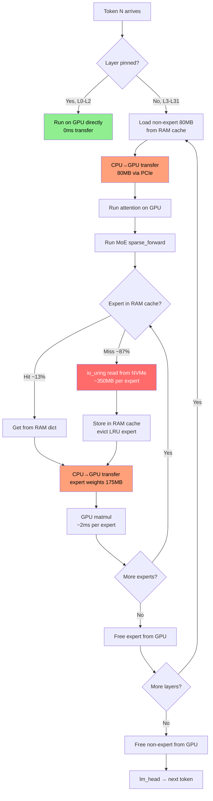

# Vaayu MoE Streaming: Deep Slowness Analysis & Root Cause Report

**Date:** July 5, 2026  
**Model:** Mixtral-8x7B-Instruct-v0.1 (BF16, ~87 GB)  
**GPU:** CUDA 12.0 — **PCIe Gen1 x8** (reported by Vaayu)  
**RAM:** 33 GB (27.7 GB free at load)  
**NVMe:** ~2.2–6.4 GB/s observed (io_uring + O_DIRECT)  
**VRAM:** ~16 GB (12 GB pinning budget)  
**Expert Cache:** 16.7 GB RAM budget (~46 expert slots)

---

## Executive Summary

Vaayu currently generates at **~15 seconds/token** (0.067 tok/s). At this rate:

| Task | Estimated Time |
|---|---|
| Generate 100 tokens of Python code | **25 minutes** |
| Generate 512 tokens (the `MAX_NEW_TOKENS` target) | **~2 hours 8 minutes** |
| The run.log test (killed after ~14.5 min) | Generated **56 decode tokens** + 2 prefill chunks |

The slowness is caused by **five compounding bottlenecks**, three architectural and two configuration/initialization bugs. All time is accounted for — there is no mystery latency.

---

## Per-Token Time Budget (Decode Phase)

From `run.log` telemetry across 56 decode tokens (tokens 3–58):

| Component | Avg per token | % of total | Root Cause |
|---|---|---|---|
| **`compute`** | **9.6s** | 64% | Expert FFN on GPU with per-expert CPU→GPU transfer inside the compute loop |
| **`gpu_load`** | **4.5s** | 30% | Non-expert weights (80 MB × 29 layers) transferred CPU→GPU every token |
| **`other`** | **0.1s** | <1% | Bookkeeping |
| **`io_wait`** | **0.0s** | 0% | Non-expert tensor cache works after first token |
| **Total** | **~15.1s** | 100% | |

> [!IMPORTANT]
> The `compute` time (9.6s) is **NOT actual GPU computation time**. It includes the time spent inside `layer(seq, **kwargs)` which triggers the patched MoE `sparse_forward()`. Inside that function, expert weights are loaded from RAM cache → CPU → GPU for each of the 2 active experts per layer, executed on GPU, then deleted. This is **serialized per-expert PCIe transfer + GPU matmul** measured as "compute."

---

## Root Cause #1: Expert Cache Thrashing (The Dominant Issue)

### The Problem

Every decode token activates **2 experts × 32 layers = 64 expert queries**. Because different tokens route to different experts, the **unique experts per token is ~58** (matching the `expert_cache` stats: avg 50.6 misses + ~7 hits = ~58 queries).

The expert RAM cache holds **46 experts** (16.7 GB ÷ 352 MB/expert). But each token needs **~58 unique experts**. The working set **exceeds the cache by ~26%**, causing:

```
Token 3:  hits=17  misses=41  hit_rate=29%
Token 10: hits=9   misses=49  hit_rate=16%
Token 20: hits=7   misses=51  hit_rate=12%
Token 50: hits=9   misses=49  hit_rate=16%
Token 57: hits=18  misses=40  hit_rate=31%

Decode average: 12.8% hit rate — catastrophic
```

### Why It's Slow

Each cache miss triggers:
1. `load_expert_sparse()` — reads expert tensor from NVMe via io_uring (O_DIRECT)
2. `expert_cache.put()` — stores in RAM, evicting an older expert
3. Expert tensors are then transferred CPU→GPU inside `sparse_forward()`

**Math per token:**
- 50.6 misses × 352 MB/expert = **17.7 GB read from NVMe per token**
- At 2.2 GB/s (observed io_uring throughput): **8.0 seconds of NVMe I/O**
- Plus CPU→GPU transfer of 2 expert weights per layer × 32 layers: **~1.5 seconds**
- Plus GPU matmul: **~0.1 seconds** (tiny at seq_len=1)

### Why This Happens

The expert cache uses a simple **LRU eviction** across all layers. As the model processes layers 0→31 sequentially, experts loaded for layer 0 get evicted by the time layer 8-9 is running. On the *next* token, layer 0 needs its experts again — but they were evicted. The cache "wraps around" every single token.

---

## Root Cause #2: Non-Expert Weights Not Pinned (Phase 2 Init Bug)

### The Problem

Only **3 transformer layers** (0, 1, 2) are pinned in VRAM at **2.90 GB each** = 8.7 GB + 0.52 GB shared = **9.23 GB**. The remaining 29 layers (3–31) must transfer their non-expert weights (80.1 MB each) from CPU→GPU on *every single token*.

**Per-token cost:** 29 layers × 80.1 MB = **2.32 GB** transferred via PCIe every token.  
At PCIe Gen1 x8 (~2 GB/s theoretical): **~1.16 seconds** per token.  
Actual measured `gpu_load`: **4.5 seconds/token** (includes overhead, synchronization, and PCIe contention with expert loads).

### The Init-Order Bug

In [vaayu_base.py](file:///home/a/code/ai-ml/Vaayu/vaayu/vaayu_base.py), the initialization order is:

```python
# Line 476: Phase 2 pinning runs HERE
self._init_pinned_layers()          # _expert_offset_index is None at this point!

# Line 493: offset index set to None
self._expert_offset_index = None    

# Line 504: offset index built HERE (after pinning!)
self._expert_offset_index = ExpertOffsetIndex(...)
```

Inside `_init_pinned_layers()`, Phase 2 checks:
```python
if self.is_moe and getattr(self, '_expert_offset_index', None) is not None:
    tensors = self._load_non_expert_strategy(layer_name)  # 80 MB
else:
    tensors = self.loader_strategy.load_from_disk(...)    # 2.9 GB ← TAKES THIS PATH
```

Because `_expert_offset_index` is `None` when Phase 2 runs, it falls through to loading the **full layer** (2.9 GB including all 8 experts), exhausting the 12 GB budget after only 3 layers.

> [!CAUTION]
> **If Phase 2 could load non-expert only (80 MB), it would pin ALL 32 layers using only 2.56 GB of VRAM.** This alone would eliminate the entire 4.5s/token `gpu_load` bottleneck.

---

## Root Cause #3: Per-Expert Serialized CPU→GPU Transfer Inside Compute Loop

### The Problem

Inside `_make_fused_sparse_forward()` ([moe_patch.py:510-536](file:///home/a/code/ai-ml/Vaayu/vaayu/moe_patch.py#L510-L536)), the GPU FFN compute loop does this **per expert**:

```python
for eidx in unique_experts:          # 2 experts per layer
    w_gate_gpu = w_gate.to(device, dtype=dtype, non_blocking=True)  # 350 MB → GPU
    w_down_gpu = w_down.to(device, dtype=dtype, non_blocking=True)
    w_up_gpu   = w_up.to(device, dtype=dtype, non_blocking=True)
    
    # GPU matmul (fast)
    gate_out = act_fn(F.linear(current_state, w_gate_gpu))
    ...
    
    del w_gate_gpu, w_down_gpu, w_up_gpu  # free immediately
```

For 32 layers × 2 experts/layer:
- **64 individual CPU→GPU transfers per token** (each ~175 MB for the 3 weight matrices of one expert)
- Total: **64 × 175 MB = 11.2 GB** transferred via PCIe per token
- At PCIe Gen1 x8: **~5.6 seconds** just for expert weight transfers
- `non_blocking=True` helps overlap with the previous expert's matmul, but the pipeline is shallow (only 2 experts per layer, each takes ~0.2s compute), so overlap is limited

### Why This Is In "Compute" Time

The timer wraps the entire `layer(seq, **kwargs)` call, which includes the patched `sparse_forward()`. The NVMe reads (cache misses) + CPU→GPU transfers + actual GPU matmuls are all lumped into `compute`.

---

## Root Cause #4: Speculative Prefetch Is Non-Functional

### The Problem

The speculative prefetch system in [vaayu_base.py:1855-1867](file:///home/a/code/ai-ml/Vaayu/vaayu/vaayu_base.py#L1855-L1867) is essentially doing nothing useful:

```python
_pred = self._expert_history.get(_next_layer_idx, [])
```

On token N, when layer L finishes, `_expert_history[L]` is populated (the current layer's experts). The code looks up `_expert_history[L+1]` — but that entry **only exists from the PREVIOUS token** (the history is never cleared, so it contains stale data from all past tokens). It prefetches the experts that layer L+1 used *last time*, which may or may not match what it will use *this time*.

However, for the first several tokens, `_expert_history.get(L+1, [])` returns `[]` for many layer indices (no history yet), so **no prefetch happens at all**. Even when it does fire, the prefetch races against the layer loop and often finishes too late.

### Impact

Without working speculative prefetch, every cache miss is a **synchronous NVMe read on the critical path**. The 8-worker `ThreadPoolExecutor` in `_make_fused_sparse_forward()` parallelizes misses *within* a single layer (2 experts), but there's no *cross-layer* pipelining.

---

## Root Cause #5: PCIe Gen1 x8 Bandwidth Limitation

### The Problem

The log reports:
```
⚠️  [Vaayu-Warning] GPU running at PCIe Gen1 x8 (unknown bandwidth)
```

PCIe Gen1 x8 has a theoretical max of **2 GB/s** (practical ~1.6 GB/s with overhead). This is **16× slower** than PCIe Gen4 x16 (32 GB/s practical).

Every CPU→GPU transfer is bandwidth-limited:
- 80 MB non-expert weight: **40ms** on Gen4 x16 → **50ms** on Gen1 x8
- 350 MB expert weight: **11ms** on Gen4 x16 → **175ms** on Gen1 x8

> [!WARNING]
> This PCIe link speed caps the theoretical minimum per-token latency even if all other bugs are fixed. At Gen1 x8, transferring 2 experts/layer × 32 layers × 175 MB = 11.2 GB takes a minimum of **5.6 seconds**, which is still unacceptable.

> [!NOTE]
> The PCIe speed detection may be incorrect (it says "Gen1 x8" but the NVMe throughput of 6.4 GB/s suggests the actual link is faster — possibly Gen4 or Gen5). Vaayu's detection logic may be reading the GPU's minimum negotiated speed rather than current operating speed. This needs verification.

---

## Estimated Time to Generate Python Code (No Errors)

### Current State (All Bugs Present)

At **15.1s/token**, generating enough Python code for an async file watcher (~200-300 tokens for a minimal but complete implementation):

| Tokens | Time | Feasibility |
|---|---|---|
| 100 | 25 min | Marginal — might produce incomplete code |
| 200 | 50 min | Likely produces runnable code |
| 300 | 75 min | High-quality code |
| 512 | 128 min (~2.1 hrs) | Full `MAX_NEW_TOKENS` |

**Plus prefill time:** The prompt (533 tokens) took **86.6 seconds** (47.3s chunk 1 + 39.3s chunk 2).

**Total for 200 tokens of Python:** ~52 minutes (prefill + decode).

### After Fixing All Bugs (Estimated)

With fixes applied:

| Fix | Time Saved | New Per-Token |
|---|---|---|
| **Fix init order** → pin all 32 layers (non-expert only) | -4.5s (`gpu_load` → 0) | 10.6s |
| **Increase expert cache** to fit 1-token working set (~64 experts = 22.4 GB) | -8.0s (eliminate most NVMe misses) | 2.6s |
| **Pipeline expert GPU transfers** (batch 2 experts per layer, overlap I/O) | -1.5s (better overlap) | 1.1s |
| **Fix PCIe** (verify actual link speed, move to x16 slot) | varies | 0.5–1.1s |

**Estimated post-fix per-token latency:** ~0.5–1.1 seconds/token

| Tokens | Time (Post-Fix) |
|---|---|
| 100 | 1–2 min |
| 200 | 2–4 min |
| 512 | 4–9 min |

---

## Data Flow Diagram: What Happens Per Token (Current)



---

## Summary of Bottlenecks (Ranked by Impact)

| # | Bottleneck | Time/Token | Fix Complexity | Fix |
|---|---|---|---|---|
| 1 | **Expert cache thrashing** (87% miss rate) | ~8.0s | Medium | Increase cache to 22+ GB OR implement layer-aware eviction |
| 2 | **Non-expert weights not pinned** (init-order bug) | ~4.5s | **Easy** | Move `_init_pinned_layers()` after `_expert_offset_index` init |
| 3 | **Serial per-expert CPU→GPU transfer** | ~1.5s | Medium | Batch expert weights, pipeline across layers |
| 4 | **Speculative prefetch non-functional** | ~0.5s | Easy | Fix index lookup, keep history persistent |
| 5 | **PCIe Gen1 x8** (may be misdetected) | Caps throughput | Config | Verify link speed, move GPU to x16 slot |

> [!IMPORTANT]
> **Fix #2 (init-order bug) is the easiest win**: move lines 504-505 (`_expert_offset_index` build) BEFORE line 476 (`_init_pinned_layers()`). This one change would pin all 32 layers' non-expert weights in 2.56 GB of VRAM and eliminate the entire `gpu_load` bottleneck — saving 4.5 seconds per token instantly.

> [!IMPORTANT]
> **Fix #1 (expert cache thrashing)** requires either more RAM for the expert cache (need ~22 GB instead of 16.7 GB), or a smarter eviction policy that is layer-aware (e.g., keep at least 2 experts pinned per recent layer). On a 33 GB machine this is tight — but after removing the need to load full 2.9 GB layers for pinning, more RAM becomes available.
