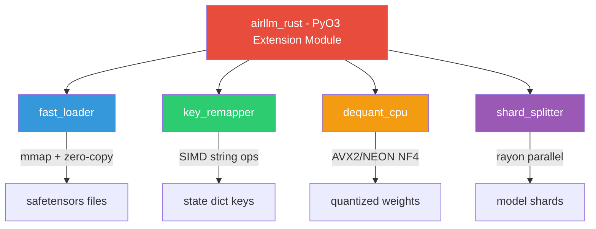

# AirLLM — Rust Optimization Analysis

## Architecture Summary

AirLLM is a **layer-streaming inference engine** that runs massive LLMs (70B+) on 4GB VRAM by:

1. **Splitting** model shards into per-layer `.safetensors` files on disk
2. **Loading** one layer at a time from disk → CPU → GPU
3. **Running** the layer's forward pass, then evicting it from GPU
4. **Prefetching** the next layer in a background thread while the current layer runs

The bottleneck is overwhelmingly **disk I/O and data movement**, not GPU compute. This makes it an ideal candidate for Rust acceleration.

---

## 🦀 Rust Optimization Candidates

### 1. Safetensor Disk Loader (HIGH IMPACT)

**File**: [safetensor_model_persister.py](file:///c:/laragon/www/AI-ML/Vaayu/air_llm/airllm/persist/safetensor_model_persister.py)  
**File**: [utils.py](file:///c:/laragon/www/AI-ML/Vaayu/air_llm/airllm/utils.py#L115-L131)

**What it does**: Reads `.safetensors` files from disk via Python's `safetensors.torch.load_file()`, then returns a state dict of CPU tensors.

**Why Rust helps**:
- The Python `safetensors` library already has a Rust backend, but the Python wrapper adds overhead (GIL, Python dict construction, memory copies)
- A custom Rust loader could **memory-map** the file and return tensors as zero-copy views directly into the mmap region
- On Windows, this avoids the double-buffer (read syscall → Python bytes → torch tensor)
- Could use **async I/O** (io_uring on Linux, IOCP on Windows) to overlap disk reads with tensor construction

**Estimated speedup**: 20-40% on layer load time (which is the dominant cost)

```
┌─────────────────────────────────────────────────────┐
│ Current:  Disk → read() → Python bytes → Torch CPU  │
│ Rust:     Disk → mmap() → zero-copy Torch CPU view  │
└─────────────────────────────────────────────────────┘
```

---

### 2. State-Dict Key Remapping & Normalization (MEDIUM IMPACT)

**File**: [utils.py](file:///c:/laragon/www/AI-ML/Vaayu/air_llm/airllm/utils.py#L360-L367) — `split_and_save_layers()`  
**File**: [airllm_base.py](file:///c:/laragon/www/AI-ML/Vaayu/air_llm/airllm/airllm_base.py#L448-L496) — `move_layer_to_device()`

**What it does**: On every forward pass, iterates all state dict keys to:
- Strip unknown architectural prefixes (`k.find(layer)` + slicing)
- Apply path remappings for VLM wrappers
- Classify params as quantized vs standard

**Why Rust helps**:
- These are pure string-processing loops over potentially hundreds of keys per layer
- Rust's zero-cost abstractions and SIMD string matching (`memchr`) would eliminate Python loop overhead
- Could be exposed via PyO3 as a single function: `remap_state_dict(keys, remappings) → new_keys`

**Estimated speedup**: 5-10× on the remapping step (small absolute time, but adds up over 80+ layers)

---

### 3. Compression / Decompression Pipeline (HIGH IMPACT)

**File**: [utils.py](file:///c:/laragon/www/AI-ML/Vaayu/air_llm/airllm/utils.py#L85-L113) — `uncompress_layer_state_dict()`  
**File**: [utils.py](file:///c:/laragon/www/AI-ML/Vaayu/air_llm/airllm/utils.py#L157-L176) — `compress_layer_state_dict()`

**What it does**: NF4/8-bit dequantization using `bitsandbytes`. For each weight tensor:
- Parses quant state from dict keys (string matching with `'4bit'`, `'8bit'`)
- Calls `bnb.functional.dequantize_nf4()` or `dequantize_blockwise()`

**Why Rust helps**:
- The dict-key parsing and quant-state reconstruction is pure Python overhead
- The actual dequantization kernel runs on CUDA, but the **orchestration** (building `QuantState` objects, routing keys) is Python
- A Rust module could fuse the "parse keys → build quant state → invoke dequant kernel" into a single call
- Could also implement a **pure CPU dequantization path** in Rust+SIMD for CPU-only inference, removing the bitsandbytes dependency entirely

**Estimated speedup**: 15-30% on compressed model loading

---

### 4. Layer Splitting / Shard Indexing (MEDIUM IMPACT, ONE-TIME)

**File**: [utils.py](file:///c:/laragon/www/AI-ML/Vaayu/air_llm/airllm/utils.py#L188-L391) — `split_and_save_layers()`

**What it does**: First-run preprocessing — reads multi-GB shard files, extracts per-layer weights, saves them as individual `.safetensors`. Involves:
- JSON index parsing
- Shard filename resolution (complex string parsing with splits)
- Sequential load/extract/save loop

**Why Rust helps**:
- This is a one-time operation but can take **10-30 minutes** for 70B models
- Rust could do parallel shard processing with rayon
- Direct safetensors binary format writing without going through Python
- Memory-mapped reads to avoid loading entire shards into RAM

**Estimated speedup**: 3-5× on initial model splitting

---

### 5. Memory Management (`clean_memory()`) (LOW-MEDIUM IMPACT)

**File**: [utils.py](file:///c:/laragon/www/AI-ML/Vaayu/air_llm/airllm/utils.py#L74-L82)

**What it does**: Calls `gc.collect()`, `malloc_trim(0)` via ctypes, and `torch.cuda.empty_cache()`.

**Why Rust helps**:
- A Rust allocator (e.g., jemalloc/mimalloc) for the tensor staging area could avoid fragmentation
- Custom arena allocator for layer state dicts: pre-allocate a fixed buffer, load into it, then hand off to CUDA. No Python GC pressure
- Would need to manage the CPU→GPU staging buffer as a ring buffer

**Estimated speedup**: Reduces GC pauses that currently cause 50-200ms stalls per layer

---

## Recommended Rust Crate Architecture



### Proposed Module: `airllm_rust`

| Component | Priority | Input | Output | Binding |
|-----------|----------|-------|--------|---------|
| `fast_loader` | 🔴 P0 | file path | `Dict[str, torch.Tensor]` | PyO3 + numpy interop |
| `dequant_cpu` | 🔴 P0 | quantized bytes + quant state | `torch.Tensor` (f16) | PyO3 + raw pointer |
| `key_remapper` | 🟡 P1 | keys list + remap rules | remapped keys list | PyO3 |
| `shard_splitter` | 🟡 P1 | shard dir path + config | per-layer files | PyO3 (CLI also) |
| `arena_alloc` | 🟢 P2 | buffer size | staging buffer handle | PyO3 + ctypes |

---

## Summary & Recommendation

> [!IMPORTANT]
> The **#1 bottleneck** in AirLLM is disk I/O → CPU → GPU data movement. Start with `fast_loader` (mmap-based safetensor reader) as the Rust module — it touches the hottest path and is self-contained enough to build and test independently.

**Recommended order of implementation:**
1. `fast_loader` — mmap safetensor reader (biggest bang for buck)
2. `dequant_cpu` — CPU-side NF4/INT8 dequantization in Rust+SIMD
3. `shard_splitter` — parallel model splitting
4. `key_remapper` — string processing acceleration
