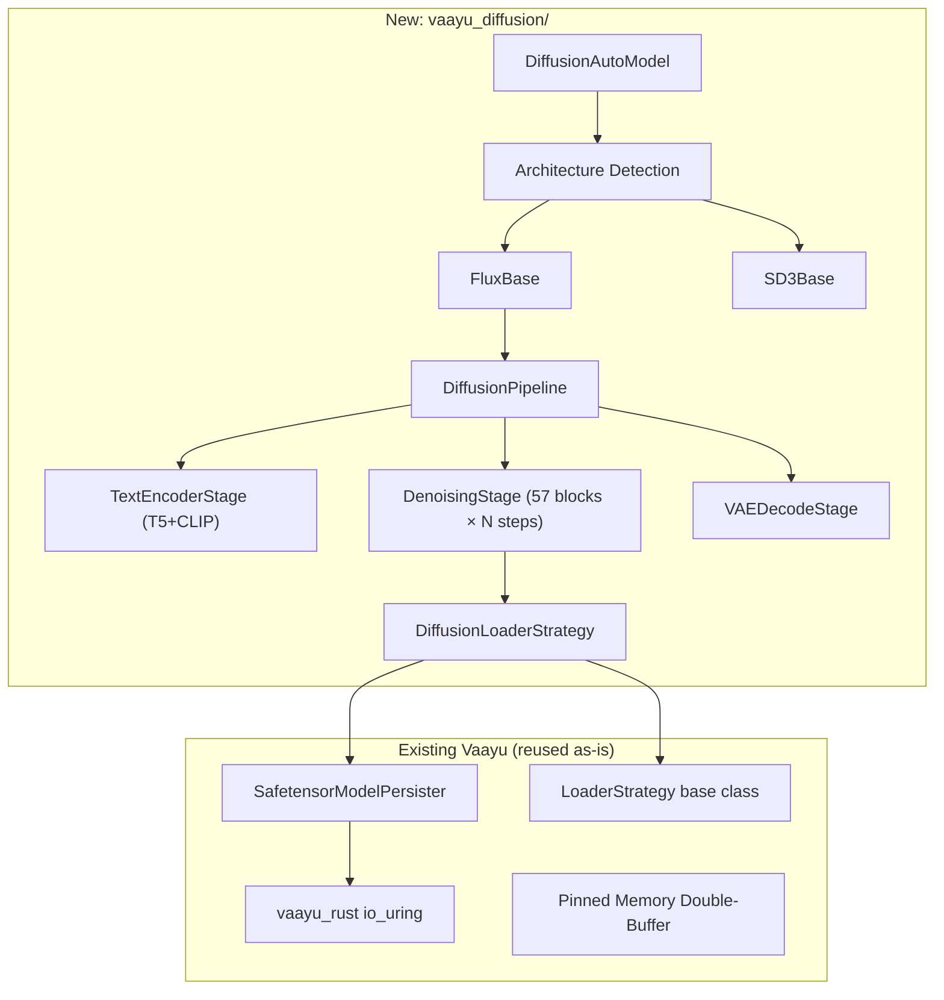

# VaayuDiffusion — Layer-Streaming for Text-to-Image Models

## Goal

Add text-to-image generation to Vaayu by creating a new `vaayu_diffusion` module that reuses the existing NVMe→GPU layer-streaming pipeline (`vaayu_rust`, pinned memory double-buffers, `LoaderStrategy`) to run large diffusion transformers (FLUX.1-dev 12B, SD3.5 Large 8B) on a single 16 GB GPU.

## Why This Is Feasible

Modern text-to-image models have shifted from UNets to **Diffusion Transformers (DiT/MMDiT)** — architecturally they are sequential stacks of transformer blocks, just like LLMs. This makes them directly compatible with Vaayu's layer-streaming approach.

**FLUX.1-dev breakdown:**

| Component | Size (FP16) | Architecture | Streaming Strategy |
|-----------|-------------|-------------|-------------------|
| **CLIP-L text encoder** | ~235 MB | Small transformer | Pin permanently in VRAM |
| **T5-XXL text encoder** | ~9.2 GB | 24 transformer layers | **Layer-stream once** per image |
| **FLUX Transformer (MMDiT)** | ~23 GB | 19 double + 38 single = 57 blocks | **Layer-stream per denoising step** |
| **VAE decoder** | ~160 MB | ConvNet | Pin permanently in VRAM |
| **Total** | **~33 GB** | — | Fits in 16 GB via streaming |

The critical insight: FLUX's 57 transformer blocks are sequential and independent — exactly like LLM layers. Each block is ~400 MB in FP16. We load one block, run it, free it, load the next.

### Performance Estimate (16 GB GPU, NVMe @ 5.5 GB/s)

```
T5-XXL encoding:     24 layers × 1 pass  = 24 layer loads  → ~2s
FLUX transformer:    57 blocks × 20 steps = 1,140 layer loads → ~80s  
VAE decode:          pinned, ~0.5s
─────────────────────────────────────────────────────────────────
Total per image:     ~83s (1.4 minutes) at 1024×1024
```

This is practical — early Stable Diffusion v1 took 1-2 minutes on consumer GPUs and was widely used.

---

## User Review Required

> [!IMPORTANT]
> **New project or in-tree module?** The plan below creates `vaayu_diffusion/` as a sibling package inside the existing Vaayu repo, sharing `vaayu_rust` and `vaayu/persist/`. Alternatively, this could be a completely separate repo that imports `vaayu_rust` as a dependency. Which do you prefer?

> [!IMPORTANT]  
> **Target model priority:** FLUX.1-dev (12B) is the primary target because it's the largest and most Vaayu-beneficial. SD3.5 Large (8B) and SDXL would follow. Do you want to start with FLUX only, or plan for multi-model support from day one?

> [!IMPORTANT]
> **Quantization support:** FLUX has FP8 and NF4 quantized variants that reduce the transformer from 23 GB → ~12 GB. Should we support quantized FLUX from the start (reuse EXL3/bitsandbytes strategies), or start with FP16/BF16 only?

## Open Questions

> [!WARNING]
> **T5-XXL streaming:** T5-XXL is an encoder-decoder model but only the encoder is used. Its 24 encoder layers are sequential and streamable. However, diffusers loads it as a frozen `T5EncoderModel` — we'd need to either (a) build a layer-streaming wrapper for T5, or (b) just use diffusers' built-in CPU offloading for T5 since it only runs once. Which approach do you prefer?

> [!NOTE]
> **Scheduler choice:** FLUX uses Flow Matching (Rectified Flow) with the `FlowMatchEulerDiscreteScheduler`. This is handled by diffusers and doesn't need custom implementation — we just call `scheduler.step()` between transformer passes.

---

## Proposed Changes

### Architecture Overview



---

### Shared Infrastructure (reused, no changes)

#### `vaayu_rust/` — Zero changes needed
The Rust io_uring extension is model-agnostic. It reads bytes from safetensors files into pinned buffers. Works identically for diffusion model weights.

#### `vaayu/persist/safetensor_model_persister.py` — Zero changes needed  
Pinned memory double-buffer, io_uring integration, safetensors header parsing — all generic.

#### `vaayu/persist/loader_strategy.py` — Minor refactor
Extract `LoaderStrategy` ABC and `StandardSafetensorsStrategy` into a shared location so `vaayu_diffusion` can import them without importing all of `vaayu`.

---

### New Package: `vaayu_diffusion/`

#### [NEW] `vaayu_diffusion/__init__.py`
Public API exports: `DiffusionAutoModel`, `FluxLayerStreamingModel`.

---

#### [NEW] `vaayu_diffusion/auto_model.py`
Entry point mirroring `vaayu/auto_model.py`. Detects diffusion model type from config:

```python
class DiffusionAutoModel:
    @classmethod
    def from_pretrained(cls, model_path, **kwargs):
        config = load_config(model_path)
        if is_flux(config):
            return FluxLayerStreamingModel(model_path, **kwargs)
        elif is_sd3(config):
            return SD3LayerStreamingModel(model_path, **kwargs)
        raise ValueError(f"Unknown diffusion architecture")
```

---

#### [NEW] `vaayu_diffusion/base.py` — `DiffusionBaseModel`
Core streaming engine for diffusion models. Analogous to `VaayuBaseModel` but with a denoising loop instead of autoregressive generation.

**Key differences from VaayuBaseModel:**

| Aspect | VaayuBaseModel (LLM) | DiffusionBaseModel (new) |
|--------|---------------------|-------------------------|
| **Forward loop** | 1 pass through all layers per token | 1 pass through all blocks per denoising step × N steps |
| **Input** | Token IDs → embedding | Latent noise tensor + text conditioning |
| **Output** | Logits → next token | Denoised latents → VAE → image |
| **KV cache** | Grows across tokens | None — but text conditioning is constant across steps |
| **Layer pinning** | First N transformer layers | CLIP + VAE pinned; first N transformer blocks |
| **Prefetching** | Next layer while current computes | Same — next block while current computes |

**Core loop pseudocode:**
```python
def generate(self, prompt, num_steps=20, guidance_scale=3.5):
    # Phase 1: Text encoding (stream T5-XXL once, CLIP is pinned)
    text_embeds = self._encode_text(prompt)  # layer-stream T5
    
    # Phase 2: Initialize latents (random noise)
    latents = torch.randn(1, 16, H//8, W//8, device=self.device)
    
    # Phase 3: Denoising loop
    self.scheduler.set_timesteps(num_steps)
    for t in self.scheduler.timesteps:
        # Stream all 57 transformer blocks for this step
        noise_pred = self._stream_transformer_forward(
            latents, text_embeds, timestep=t
        )
        latents = self.scheduler.step(noise_pred, t, latents).prev_sample
    
    # Phase 4: VAE decode (pinned in VRAM)
    image = self.vae.decode(latents)
    return image
```

---

#### [NEW] `vaayu_diffusion/flux.py` — `FluxLayerStreamingModel`
FLUX-specific implementation.

**Responsibilities:**
1. **Model init**: Create `FluxTransformer2DModel` with `init_empty_weights()`, split into per-block safetensors
2. **Block splitting**: Split FLUX weights into:
   ```
   splitted_model/
   ├── x_embedder.safetensors          # image input projection (~small)
   ├── context_embedder.safetensors    # text input projection (~small)  
   ├── time_text_embed.safetensors     # timestep + text pooled projection
   ├── double_blocks.0.safetensors     # ~400 MB each
   ├── double_blocks.1.safetensors
   ├── ... (19 double blocks)
   ├── single_blocks.0.safetensors     # ~200 MB each
   ├── single_blocks.1.safetensors
   ├── ... (38 single blocks)
   ├── norm_out.safetensors
   └── proj_out.safetensors
   ```
3. **Forward streaming**: For each denoising step, stream blocks sequentially:
   - Compute embeddings (pinned: `x_embedder`, `context_embedder`, `time_text_embed`)
   - Stream 19 double blocks (image + text parallel attention)
   - Concatenate streams, stream 38 single blocks
   - Apply `norm_out` + `proj_out` (pinned)
4. **Rotary position embeddings**: Compute once, reuse across all steps

---

#### [NEW] `vaayu_diffusion/text_encoder.py` — `StreamingTextEncoder`
Layer-streaming wrapper for T5-XXL encoder.

- T5-XXL has 24 encoder layers — each ~380 MB in FP16
- Runs once per image (not per denoising step)
- Reuses the same `SafetensorModelPersister` and double-buffer pipeline
- CLIP-L is small enough to load entirely into VRAM

---

#### [NEW] `vaayu_diffusion/vae.py` — `PinnedVAEDecoder`
Thin wrapper around the VAE decoder.

- Only ~160 MB — permanently pinned in VRAM
- Called once at the end to convert latents → pixels
- Standard `diffusers` VAE, no streaming needed

---

#### [NEW] `vaayu_diffusion/scheduler.py` — Scheduler utilities
Wraps `diffusers` schedulers (no custom implementation needed):

```python
from diffusers import FlowMatchEulerDiscreteScheduler
```

Just initialization and `step()` calls between transformer passes.

---

#### [NEW] `vaayu_diffusion/splitter.py` — Diffusion model weight splitter
Analogous to `vaayu/utils.py:split_and_save_layers()` but aware of diffusion model structure:

- Splits transformer blocks into per-block `.safetensors`  
- Splits T5-XXL encoder layers into per-layer `.safetensors`
- Keeps CLIP-L and VAE as single files (small enough to load whole)

---

### VRAM Budget Analysis (16 GB GPU, FLUX.1-dev FP16)

```
Total VRAM:                          16.0 GB
━━━━━━━━━━━━━━━━━━━━━━━━━━━━━━━━━━━━━━━━━━
CUDA context + overhead:             -1.0 GB
CLIP-L encoder (pinned):             -0.24 GB
VAE decoder (pinned):                -0.16 GB
Latent tensors (1024×1024):          -0.13 GB
Text conditioning tensors:           -0.10 GB
Pinned memory double-buffer:         -0.90 GB (2 × 450 MB for largest block)
━━━━━━━━━━━━━━━━━━━━━━━━━━━━━━━━━━━━━━━━━━
Available for streaming + pinning:    13.47 GB

Largest double_block:                ~400 MB
→ Can pin ~30 blocks permanently      12.0 GB (30 × 400 MB)
→ Stream remaining 27 blocks per step

With 30 blocks pinned:
  Per-step streaming: 27 blocks × 400 MB ÷ 5.5 GB/s ≈ 1.96s
  20 steps: ~39s (vs. 80s with no pinning)
```

> [!TIP]
> With asymmetric block pinning, generation time drops from ~83s to ~42s per image. Even better with FP8 quantized FLUX (~12 GB transformer → could pin nearly all blocks).

---

### File Tree Summary

```
Vaayu/
├── vaayu/                    # Existing LLM engine (unchanged)
│   ├── persist/
│   │   ├── loader_strategy.py    # Minor: extract shared ABC
│   │   └── safetensor_model_persister.py  # Reused as-is
│   └── ...
├── vaayu_diffusion/          # NEW: Diffusion engine
│   ├── __init__.py
│   ├── auto_model.py         # DiffusionAutoModel entry point
│   ├── base.py               # DiffusionBaseModel (denoising loop)
│   ├── flux.py               # FLUX-specific: block structure, forward
│   ├── text_encoder.py       # Streaming T5-XXL encoder
│   ├── vae.py                # Pinned VAE decoder wrapper
│   ├── scheduler.py          # Scheduler utilities (wraps diffusers)
│   └── splitter.py           # Diffusion-aware weight splitter
├── vaayu_rust/               # Existing Rust io_uring (unchanged)
├── test_flux.py              # NEW: Quick test script for FLUX
└── requirements_diffusion.txt # NEW: Additional deps (diffusers, etc.)
```

---

## Verification Plan

### Automated Tests

1. **Weight splitting test**: Verify FLUX transformer splits into correct per-block safetensors
2. **Single-block streaming test**: Load one double_block via io_uring, inject to GPU, run forward, free — verify no VRAM leak
3. **Full generation test**: `python test_flux.py` with FLUX.1-dev produces a valid PNG image
4. **VRAM monitoring**: Peak VRAM stays under 15 GB throughout generation

### Manual Verification

1. **Image quality**: Generated images should match diffusers pipeline output for same prompt + seed
2. **Performance benchmarking**: Measure per-step time, total generation time, NVMe throughput
3. **Pinning sweep**: Test `max_pinned_blocks=0` (stream all) vs `-1` (auto-fill) vs `N`
