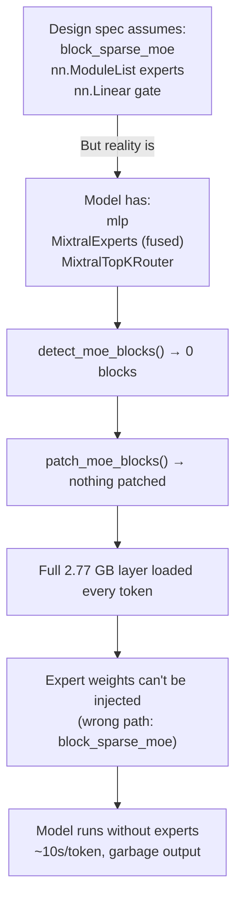

# 🔍 Deep Debug: Why Vaayu MoE Streaming Is Loading ALL Experts

## The Smoking Gun

From the logs, line 572:
```
[Vaayu-MoE] 0 MoE blocks patched for sparse streaming
```

**Zero MoE blocks were patched.** The sparse streaming system is completely inert. Vaayu is falling back to loading **full 2.77 GB per layer** (all 8 experts) on every single token, instead of only the ~690 MB needed for the 2 active experts.

---

## Root Cause: Three Cascading Failures

The design spec and implementation were built assuming a specific Mixtral model structure that **no longer exists** in modern `transformers`. The HuggingFace `transformers` library has refactored Mixtral's architecture, and the code is trying to match an outdated structure.

### Failure #1: `detect_moe_blocks()` finds 0 blocks

[moe_patch.py](file:///home/a/code/ai-ml/Vaayu/vaayu/moe_patch.py) `detect_moe_blocks()` scans the model for modules that contain:
1. An `nn.ModuleList` with > 4 children (the expert FFN list)
2. A sibling `nn.Linear` named `gate` or `router`

**What the code expects (old transformers):**
```
model.layers.0.block_sparse_moe
  ├── gate: nn.Linear           ← router
  └── experts: nn.ModuleList    ← 8 expert MLP modules
```

**What the model actually has (current transformers):**
```
model.layers.0.mlp              ← MixtralSparseMoeBlock
  ├── gate: MixtralTopKRouter   ← NOT nn.Linear!
  └── experts: MixtralExperts   ← NOT nn.ModuleList!
```

Three mismatches:
1. **Path**: The MoE block lives at `model.layers.0.mlp`, **not** `model.layers.0.block_sparse_moe`
2. **Router type**: `gate` is a `MixtralTopKRouter`, **not** `nn.Linear` → fails the `isinstance(child, nn.Linear)` check in `detect_moe_blocks()`
3. **Experts type**: `experts` is a `MixtralExperts` (fused batch module with `gate_up_proj` and `down_proj` tensors), **not** `nn.ModuleList` → fails the `isinstance(child, nn.ModuleList)` check

Since both checks fail, `detect_moe_blocks()` returns an empty list → 0 blocks patched.

### Failure #2: Router gate pinning fails silently

[vaayu_base.py:986-1038](file:///home/a/code/ai-ml/Vaayu/vaayu/vaayu_base.py#L986-L1038) Phase 1.5 tries to pin router gate weights to VRAM. It reads the safetensor header and finds keys like `model.layers.0.block_sparse_moe.gate.weight`, then calls `inject_to_gpu()` which calls `set_module_tensor_to_device()`.

But the **model has no `block_sparse_moe` attribute** on `MixtralDecoderLayer` — the MoE block is at `.mlp` instead. So injection fails with:
```
'MixtralDecoderLayer' object has no attribute 'block_sparse_moe'
```

This is logged for **all 32 layers** (lines 75-170 of the log). The gates are never actually pinned to VRAM, which means even if patching worked, the sparse forward couldn't run the router.

### Failure #3: Full layer loading also fails to inject expert weights

During the forward pass, the standard `move_layer_to_device()` loads the full 2.77 GB safetensor for each layer. The tensor keys in the files use the **old naming** (`model.layers.0.block_sparse_moe.experts.0.w1.weight`), but the model's live module tree uses the **new naming** (`model.layers.0.mlp.experts.gate_up_proj`).

`set_module_tensor_to_device()` traverses the model tree following the dotted path. When it hits `block_sparse_moe`, it can't find that attribute → **every single expert weight injection fails**:
```
[Vaayu] Warning: could not inject model.layers.0.block_sparse_moe.experts.0.w1.weight: 
'MixtralDecoderLayer' object has no attribute 'block_sparse_moe'
```

That's **25 warnings per layer × 32 layers = 800 failed injections per token**.

> [!CAUTION]
> **The model is running attention-only without any MoE expert computation.** All expert weights are read from disk but silently discarded. The model is generating garbage text because the MoE FFN output is zero for every layer.

---

## The Performance Impact

### What's happening per token:

| Phase | Data read | Time | Purpose |
|-------|-----------|------|---------|
| Read layers 0-9 | 0 bytes | ~0s | Pinned in VRAM ✅ |
| Read layers 10-31 | 22 × 2.77 GB = **60.9 GB** | 22 × 0.46s = **~10s** | Full layer load ❌ |
| Expert injection | 22 × 25 tensors | — | **All fail silently** ❌ |
| Expert compute | — | — | **Zero output** (weights never injected) ❌ |

**~10 seconds per token** just on disk I/O, reading 60 GB of data that is mostly experts, when only ~15 GB of that data is actually needed (attention weights + 2/8 experts).

### What the design spec promised:

With sparse streaming working correctly:
- Attention weights: ~170 MB per layer (always loaded)
- Active experts only: 2/8 × 2.6 GB ≈ 650 MB per layer
- Total per layer: ~820 MB instead of 2,770 MB → **3.4× reduction**
- Plus expert caching would eliminate most disk reads after token 1

---

## What Needs to Be Fixed

### Problem 1: Checkpoint key naming vs model structure mismatch

The safetensors files have keys like:
```
model.layers.0.block_sparse_moe.experts.0.w1.weight
model.layers.0.block_sparse_moe.experts.0.w2.weight
model.layers.0.block_sparse_moe.experts.0.w3.weight
model.layers.0.block_sparse_moe.gate.weight
```

But the `AutoModelForCausalLM.from_config()` model tree has:
```
model.layers.0.mlp.gate.weight         (MixtralTopKRouter)
model.layers.0.mlp.experts.gate_up_proj (MixtralExperts — fused w1+w3)
model.layers.0.mlp.experts.down_proj    (MixtralExperts — w2)
```

There's a **double mismatch**:
1. `block_sparse_moe` → `mlp` (path rename)
2. Per-expert `w1/w2/w3` → fused `gate_up_proj/down_proj` (architecture change)

**Fix needed:** `_path_remappings` in [vaayu_base.py](file:///home/a/code/ai-ml/Vaayu/vaayu/vaayu_base.py) needs to map `block_sparse_moe` → `mlp` when the model doesn't have `block_sparse_moe` but does have `mlp` with MoE structure.

### Problem 2: `detect_moe_blocks()` detection heuristics are too narrow

**Fix needed in** [moe_patch.py](file:///home/a/code/ai-ml/Vaayu/vaayu/moe_patch.py):
- The router check should accept any module with a `weight` parameter that looks like a gate (not just `nn.Linear`). `MixtralTopKRouter` has a `.weight` inside it.
- The experts check should accept `MixtralExperts` (or any custom module that has `num_experts` attribute), not just `nn.ModuleList`.

### Problem 3: The sparse forward assumes per-expert `nn.Module` instances

The patched [sparse_forward](file:///home/a/code/ai-ml/Vaayu/vaayu/moe_patch.py#L209-L277) assumes `experts_list[eidx]` gives you a standalone MLP module per expert. In the new HF Mixtral, `MixtralExperts` is a **single fused module** that handles all experts with batched weight tensors (`gate_up_proj` shape `[num_experts, intermediate_size*2, hidden_size]`). There are no individual expert modules to inject into.

**Fix needed:** The sparse forward needs a completely different strategy for fused-expert architectures — it needs to slice the relevant expert's weights from the fused tensors and run the computation manually, rather than calling individual `expert_mod.forward()`.

### Problem 4: Expert offset index keys vs live model keys

The [ExpertOffsetIndex](file:///home/a/code/ai-ml/Vaayu/vaayu/persist/expert_offset_index.py) correctly indexes byte offsets using the safetensor file keys (`block_sparse_moe.experts.0.w1.weight`). This is fine for sparse disk reads. But the injection code then needs to remap these keys to the live model's parameter paths. Currently no such remapping exists for the MoE path.

---

## Summary: The Gap Between Design and Reality



The fundamental issue is that the `transformers` library changed the internal Mixtral module structure from individual `nn.ModuleList` experts to a **fused `MixtralExperts`** module, and from `block_sparse_moe` to `mlp` as the attribute name. The design spec and implementation were written against the old structure.
