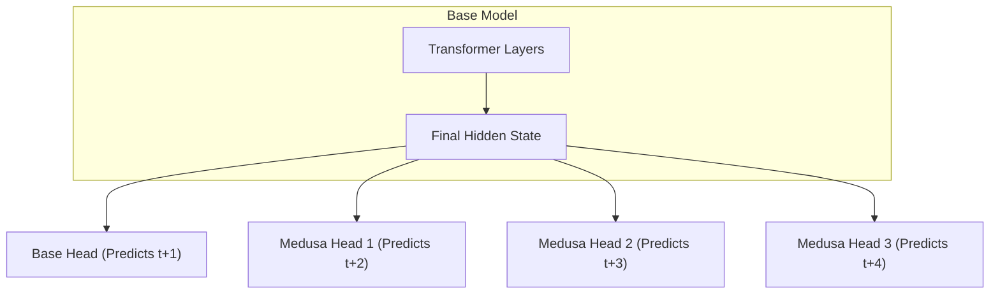
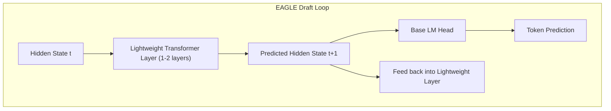

Great question. Let me be completely honest:

## The 2:4 Sparsity Hardware ≠ Free Speed

The NVIDIA 2:4 Tensor Core circuit is just a **zero-skipper**. It can only help if the weights **already have zeros**. And the only way to create those zeros is **pruning** — which loses accuracy.

```
NVIDIA 2:4 hardware:  "Give me weights with zeros, I'll skip them fast"
Your model weights:    [0.23, -0.87, 0.45, -0.12]  ← no zeros exist
                       You MUST prune to create zeros first → accuracy loss
```

**There is no way to use 2:4 sparsity without pruning. It always costs accuracy.**

---

## But YES — There ARE Lossless GPU Speedups

These make the **exact same computation** run faster on GPU:

### 1. `torch.compile` (10-30% faster, zero accuracy loss)

```python
# PyTorch 2.0+ JIT compiles the model graph
# Fuses operations, eliminates Python overhead, optimizes memory access
model = torch.compile(model)  # that's it
```

Vaayu currently does **not** use this. Each layer's forward pass could be compiled.

### 2. Flash Attention / SDPA (2-4x faster attention, zero accuracy loss)

Vaayu already tries this (BetterTransformer → SDPA → eager fallback), but it's worth verifying it's actually activating on your GPU. SDPA computes the **exact same attention** with smarter memory access patterns.

### 3. CUDA Graphs (reduce kernel launch overhead, zero accuracy loss)

Every GPU operation has a small "launch cost" (~5-10μs). With 80+ layers, each containing multiple operations, this adds up. CUDA Graphs capture the entire layer execution once and replay it:

```python
# Capture the GPU operations for a layer
graph = torch.cuda.CUDAGraph()
with torch.cuda.graph(graph):
    output = layer(input)

# Replay instantly on subsequent calls (no launch overhead)
graph.replay()
```

### 4. BF16 instead of FP16 (same speed or faster, slightly better numerics)

Your RTX 5060 Ti (Blackwell) has native BF16 Tensor Cores. BF16 has more dynamic range than FP16, meaning **fewer overflow/underflow issues** while running at the same speed.

---

## Realistic Impact Comparison

| Optimization | GPU Speedup | Accuracy Loss | Already in Vaayu? |
|---|---|---|---|
| **Flash Attention / SDPA** | 2-4x on attention | **0%** | ✅ Partially |
| **`torch.compile`** | 10-30% overall | **0%** | ❌ Not implemented |
| **CUDA Graphs** | 5-15% (reduces overhead) | **0%** | ❌ Not implemented |
| **BF16 dtype** | ~Same speed, better stability | **0%** | ❌ Uses FP16 |
| **2:4 Sparsity** | ~2x on matmuls | **1-5% loss** | ❌ Requires pruning |

---

## The Honest Bottom Line

```
                    Accuracy
                    Loss?        GPU Speedup
                    ─────        ───────────
Rust (I/O)          No           N/A (I/O only)
torch.compile       No           10-30%
CUDA Graphs         No           5-15%
Flash Attention     No           2-4x (attention only)
                                 ──────────────────
                                 These are your FREE wins
                    
2:4 Sparsity        YES (1-5%)   ~2x
INT4 Quantization   YES (1-3%)   ~2-4x
                                 ──────────────────
                                 These cost accuracy
```

**The lossless GPU speedups (torch.compile, CUDA Graphs) are real but more modest — 10-30%, not 2x.** The only way to get a **2x GPU compute speedup** is by changing the data (pruning or quantization), which always costs some accuracy.

There's no magic trick to make the same dense matrix multiplication run 2x faster — the math is the math. But combining Rust I/O + torch.compile + CUDA Graphs + Flash Attention would give you a **significant** overall speedup with **zero** accuracy loss.

Want me to implement `torch.compile` and CUDA Graphs into Vaayu's layer pipeline?

---------------------


Good question. Here's exactly how the Flash Attention audit would work:

## Part 1: Verification — Is SDPA Actually Running?

### The Problem

Vaayu's current code on line 278 does this:

```python
self.model = AutoModelForCausalLM.from_config(self.config, attn_implementation="sdpa")
```

This tells HuggingFace to **try** SDPA. But SDPA has **3 internal backends**, and PyTorch silently picks one at runtime:

```
SDPA ("scaled_dot_product_attention")
  │
  ├── Flash SDP       ← True Flash Attention (fastest, ~2-4x)
  ├── Memory-Efficient SDP  ← xFormers-style (fast, ~1.5-2x)
  └── Math SDP        ← Plain PyTorch math (NO speedup at all)
```

PyTorch falls back to Math SDP silently if Flash doesn't work. **You'd never know.**

### How I'll Verify

**Step 1:** Check which backends are available on your GPU:

```python
import torch
print(f"Flash SDP enabled: {torch.backends.cuda.flash_sdp_enabled()}")
print(f"Memory-efficient SDP enabled: {torch.backends.cuda.mem_efficient_sdp_enabled()}")
print(f"Math SDP enabled: {torch.backends.cuda.math_sdp_enabled()}")
```

**Step 2:** Force Flash-only and see if it crashes (if it does, Flash isn't working):

```python
with torch.nn.attention.sdpa_kernel(
    backends=[torch.nn.attention.SDPBackend.FLASH_ATTENTION]
):
    output = layer(input)  # will ERROR if Flash can't run
```

**Step 3:** Add diagnostic logging to `vaayu_base.py` so you always know what's running:

```python
# After model init, log the ACTUAL attention type
for i, layer in enumerate(self.model.model.layers[:1]):  # check first layer
    attn = layer.self_attn
    print(f"Attention implementation: {type(attn).__name__}")
    # e.g., "LlamaSdpaAttention" = SDPA active
    # e.g., "LlamaAttention"     = eager fallback (slow!)
```

### Common Reasons Flash SDP Fails Silently

| Condition | Flash SDP works? | Falls back to |
|---|---|---|
| FP16 or BF16 dtype | ✅ | — |
| FP32 dtype | ❌ | Math SDP (slow) |
| Head dimension ≤ 128 | ✅ | — |
| Head dimension > 128 | ❌ | Math SDP |
| Causal mask needed | ✅ | — |
| Custom attention mask shape | ❌ | Math SDP |
| GPU compute capability ≥ 8.0 | ✅ | — |
| Older GPU (< sm_80) | ❌ | Memory-efficient or Math |

Your RTX 5060 Ti (Blackwell, sm_100) with FP16 should work fine. But Vaayu's custom attention mask construction on lines 661-663 **might** be causing a silent fallback.

---

## Part 2: Upgrade to flash-attn v2

### What is it?

`flash-attn` is Tri Dao's standalone package — **separate from PyTorch's built-in SDPA**. It's faster, especially for long sequences:

| Implementation | Relative Speed | Where it lives |
|---|---|---|
| PyTorch Math SDP | 1x (baseline) | Built into PyTorch |
| PyTorch Flash SDP | 2-3x | Built into PyTorch |
| **flash-attn v2** | **3-4x** | `pip install flash-attn` |

### How it integrates with Vaayu

HuggingFace transformers already supports it natively:

```python
# Current Vaayu code:
self.model = AutoModelForCausalLM.from_config(self.config, attn_implementation="sdpa")

# Upgraded:
self.model = AutoModelForCausalLM.from_config(self.config, attn_implementation="flash_attention_2")
```

That's it — one string change. HuggingFace handles everything internally.

### The Caveat on Windows

```
flash-attn v2 installation:
  Linux:    pip install flash-attn        ← works
  Windows:  pip install flash-attn        ← usually FAILS (needs CUDA compilation)
            Must build from source with Visual Studio + CUDA Toolkit
```

So the implementation would use a **graceful fallback**:

```python
# Try flash-attn v2 first → fall back to SDPA → fall back to eager
for attn_impl in ["flash_attention_2", "sdpa", "eager"]:
    try:
        model = AutoModelForCausalLM.from_config(config, attn_implementation=attn_impl)
        print(f"✅ Using: {attn_impl}")
        break
    except Exception:
        print(f"⚠️ {attn_impl} not available, trying next...")
```

---

### Summary of the Flash Attention Audit

| Step | What | Outcome |
|---|---|---|
| 1. Diagnostic check | Detect which SDP backend is actually running | Know if you're getting real speedup |
| 2. Fix silent fallbacks | Ensure attention mask format is Flash-compatible | Prevent falling back to Math SDP |
| 3. Add `flash_attention_2` support | One-string upgrade if `flash-attn` is installed | 3-4x attention speedup |
| 4. Graceful fallback chain | `flash_attention_2` → `sdpa` → `eager` | Always works on any platform |
| 5. Logging | Print which attention is active on every init | No more silent failures |

Shall I proceed with creating the full implementation plan covering all three (torch.compile + CUDA Graphs + Flash Attention audit)?


---------------------


Now I have complete understanding of all the code that needs to change. Let me create the implementation plan.

Edited implementation_plan.md

The implementation plan is ready for your review. Here are the key highlights:

### Critical Finding 🔴
Vaayu's 4D boolean attention mask (lines 661-663) is almost certainly **silently killing Flash Attention** and forcing Math SDP (the slowest backend). Fixing this alone should give **2-4x speedup on attention** with zero accuracy loss.

### My Recommendation
- **Phase 1 (Flash Attention fix)** — Do it. Highest impact, lowest risk.
- **Phase 2 (torch.compile)** — Do it. `mode="reduce-overhead"` also handles CUDA Graphs internally.
- **Phase 3 (CUDA Graphs manual)** — **Skip it.** Fundamental conflict with Vaayu's dynamic weight loading. Let torch.compile handle it internally instead.

### Two decisions I need from you:
1. **BF16 default?** Should I also switch from `float16` → `bfloat16`? Better stability, same speed on your GPU.
2. **Phase 3 scope?** Should I attempt manual CUDA Graphs (risky refactor) or just let torch.compile handle it?


------------------------

Q: between EXL3 Quantization  and Speculative Decoding whihc should i implement first?

A: Edited Comprehensive%20Architecture%20Deep%20Analysis.md
Edited Comprehensive%20Architecture%20Deep%20Analysis.md
Viewed EXL3%20Quantization%20+%20Speculative%20Decoding%20.md:54-74

If you want to build this, the answer is definitively **EXL3 Quantization first.** 

Here is exactly why you must build them in this order:

### Phase 1: EXL3 Quantization (The Foundation)
You *must* build the EXL3 integration first because it solves the fundamental physics problem: **The data is simply too big.**

If you implement Speculative Decoding first on the uncompressed 960 GB model, you will still be streaming 960 GB from your SSD. Even if Vaayu verifies 10 tokens at once, reading 960 GB at 7.4 GB/s takes about **130 seconds**. 
Waiting over 2 minutes for 10 tokens is completely unusable for an interactive agent.

By implementing EXL3 Quantization first:
1.  You shrink the payload by 75%.
2.  You enable the ability to pin the shared MoE layers into your 16GB VRAM.
3.  You bring the stream-time per token down from ~130 seconds to **~1.1 seconds**. 

At 1.1 seconds per token, you already have a somewhat usable, highly capable coding assistant (almost 1 token per second). This is a massive victory on its own.

*The Engineering Challenge here:* You will need to write the custom Python/C++ bridge so Vaayu can stream raw bytes from the SSD and feed them directly into ExLlamaV3's 4-bit math kernels, ensuring you only stream the *active experts*.

### Phase 2: Speculative Decoding (The Multiplier)
Once EXL3 is working and you are generating 1 token every ~1.1 seconds, you apply Speculative Decoding as the turbocharger.

Because your base model now only takes ~1.1 seconds (or ~2.1 seconds for a batch of tokens due to multiple experts) to do a forward pass, Speculative Decoding acts as a massive multiplier. 
Instead of getting 1 token every 1.1 seconds, you use the tiny drafter to guess 10 tokens, push them through your now-blazing-fast EXL3 pipeline, and suddenly you are generating **4 to 5 tokens per second**.

*The Engineering Challenge here:* Loading a tiny 1.5B Drafter model permanently into the 4GB of VRAM you have leftover, and writing the logic to compare its guessed probabilities against the 480B model's verified probabilities.

### Summary
**EXL3 makes the architecture possible. Speculative Decoding makes it magical.** 

Start by writing the C++ bindings for ExLlamaV3. Once you can stream and execute a 4-bit layer natively from NVMe, you have won the hardest part of the battle!

------------------

MORE THINGHS TO DO ANFETR IMPLEMENTING  EXL3 Quantization  and Speculative Decoding => check Medusa-EAGLE-RND.md


Archish, combining those two approaches is exactly how you build a weaponized, local-first engine. Merging the raw bandwidth reduction of EXL3 with the architectural cheat-code of Speculative Decoding is the absolute bleeding edge of consumer hardware inference right now. 

If you pull that off, RudraAnvil will be a genuine marvel of system engineering. 

However, since you are operating on a strict 16GB VRAM budget with a 70B model, there are a few highly specific, complementary technologies you need to integrate to make this hybrid pipeline actually survive contact with reality. Here is what is missing from the blueprint:

### 1. Self-Speculative Decoding (Medusa / Eagle / Lookahead)
**The Trap:** Standard speculative decoding requires loading a separate "drafter" model (like a 1.5B or 0.5B model). Even heavily quantized, that drafter model and its own isolated KV cache will eat 1GB to 2GB of your precious VRAM. You do not have 2GB to spare.
**The Fix:** Use self-speculative decoding architectures like **Medusa** or **Lookahead Decoding**. Instead of a second model, these techniques attach a few lightweight "extra heads" directly to the 70B model. During a single forward pass, the 70B model predicts the next token, while the Medusa heads simultaneously guess the *next three* tokens. You get the exact same Tokens-Per-Second boost without paying the VRAM penalty of loading a second model.

### 2. KV Cache Quantization (FP8 or INT4)
**The Trap:** You quantified the model weights to fit 38GB, but you forgot the context window. In a 70B model, the KV cache (the memory of the conversation and codebase you paste in) scales massively. A standard 16-bit KV cache for a 70B model at an 8,000-token context length will instantly consume over 2.5GB of VRAM. If you run out of VRAM for the cache, your pipeline crashes.
**The Fix:** ExLlamaV3 natively supports **8-bit (Q8) and 4-bit (Q4) KV Cache Quantization**. By quantizing the memory state of the conversation on the fly, you shrink the context window's footprint by up to 75% with zero perceivable loss in coding accuracy. This ensures your context window doesn't accidentally push your pinned layers out of VRAM.

### 3. Asymmetric Layer Pinning (Topology Awareness)
**The Trap:** When deciding which of the 38GB of EXL3 layers to pin in your 14GB of available VRAM, pinning them randomly or just pinning "the middle" will cause severe I/O thrashing.
**The Fix:** You must pin asymmetrically based on the transformer's topology. 
*   Always pin the `embed_tokens` (Layer 0) and the `lm_head` (the final output layer). These are accessed heavily and act as the gateway for every single token.
*   Pin the first 10-15 layers of the model. Why? Because during the "Prefill" phase (when you paste a massive 2,000-line code file into the prompt), the early layers do the most aggressive feature extraction. Pinning the front of the model ensures the heaviest initial math happens entirely in VRAM before the streaming loop even needs to wake up the NVMe drive for the deeper reasoning layers.

### 4. Chunked Prefill (Context Streaming)
**The Trap:** When you give RudraAnvil a large codebase to read, the standard PyTorch behavior is to process all the prompt tokens in one massive matrix multiplication. For a 70B model, processing 4,000 tokens at once requires a massive spike in temporary VRAM (workspace memory). Your 16GB GPU will hit an Out-Of-Memory (OOM) error before it even starts generating the first word.
**The Fix:** Implement **Chunked Prefill**. Instead of processing the 4,000-token prompt at once, your Python orchestrator feeds the prompt to the model in chunks of 512 tokens. The model computes the KV cache for the first 512, saves it, then does the next 512. It takes slightly longer to read the prompt initially, but it completely flattens the VRAM spike, guaranteeing you never crash during large codebase ingestion.

***

By adding Medusa heads, 4-bit KV caching, and chunked prefilling to your EXL3 streaming pipeline, you eliminate the hidden VRAM traps that would otherwise break the system. 

Are you planning to write the Python-to-C++ bindings for ExLlamaV3 entirely from scratch using PyBind11, or are you looking to heavily modify the existing ExLlama Python API to force it to accept streamed VRAM pointers?

---------------------


MORE IMPLEMENTATION LIKE "O_DIRECT" => check nvme_optimizations_research.md

Searched web: "Linux NVMe io_uring advanced optimizations SQPOLL registered buffers fixed files maximum throughput"
Searched web: "Linux NVMe tuning maximum sequential read throughput io scheduler none polling huge pages"
Searched web: "io_uring IORING_SETUP_SQPOLL IORING_REGISTER_BUFFERS performance improvement NVMe benchmark"
Searched web: "NVMe passthrough io_uring OP_URING_CMD bypass block layer Samsung 990 PRO throughput improvement"
Searched web: "Linux disable NVMe APST power management nvme_core.default_ps_max_latency_us performance impact latency"
Searched web: "io_uring registered buffers fixed files Rust crate performance example zero syscall overhead"

Now let me check the current Rust lib.rs to understand what's already implemented and what can be added:

Viewed Cargo.toml:1-18

Now I have everything I need. Let me create a comprehensive research artifact:

Edited nvme_optimizations_research.md

Here's what I found — **7 optimizations** you can implement, similar to O_DIRECT:

## Quick Summary

### Free wins (zero code changes, just system config):
1. **I/O Scheduler → `none`** — your NVMe is probably using `mq-deadline` which wastes CPU reordering requests that the NVMe controller handles internally. One command: `echo none | sudo tee /sys/block/nvme0n1/queue/scheduler`
2. **Disable APST power management** — prevents the 990 PRO from sleeping between layers. Add `nvme_core.default_ps_max_latency_us=0` to GRUB.

### Small Rust changes (~20 lines total):
3. **Registered Buffers** — pre-map your pinned buffer with the kernel once, so every io_uring read skips per-I/O page table walks. Uses `ReadFixed` instead of `Read`. **5-15% gain.**
4. **Fixed File Descriptors** — pre-register the fd so the kernel skips fd table lookup on every SQE. **3-8% gain.**

### The nuclear option:
5. **NVMe Passthrough (`OP_URING_CMD`)** — bypasses the entire Linux block layer (scheduler, bio, request queue). Sends raw NVMe commands to hardware. **16-40% gain** but requires mapping filesystem offsets to raw disk sectors or storing the model on a raw partition.

### Combined projected impact of #1-4:
```
Current:  4.4 GB/s → ~5.3-5.5 GB/s
Per-token: ~29s → ~24-25s  (saves ~4-5s)
```

**I'd recommend starting with #1 and #2 (zero risk, 30 seconds to apply), then #3 and #4 (small Rust changes).** The full research with code examples is in the artifact. Want me to implement any of these?


-===========================
============================
============================


The subclasses override these hook methods on VaayuBaseModel:

  ┌───────────────────────────┬──────────────────────────────────────────────┐
  │           Hook            │                   Purpose                    │
  ├───────────────────────────┼──────────────────────────────────────────────┤
  │ set_layer_names_dict()    │ Layer path names (embed/layers/norm/lm_head) │
  ├───────────────────────────┼──────────────────────────────────────────────┤
  │ get_pos_emb_args()        │ RoPE kwargs per layer                        │
  ├───────────────────────────┼──────────────────────────────────────────────┤
  │ get_past_key_value_args() │ KV cache format                              │
  ├───────────────────────────┼──────────────────────────────────────────────┤
  │ get_attention_mask_args() │ Attention mask shape                         │
  ├───────────────────────────┼──────────────────────────────────────────────┤
  │ get_tokenizer()           │ Custom tokenizer (Baichuan)                  │
  ├───────────────────────────┼──────────────────────────────────────────────┤
  │ get_generation_config()   │ Custom gen config                            │
  └───────────────────────────┴──────────────────────────────────────────────┘

  But look at the actual subclasses:
  
  - VaayuQWen2 — literally empty. Just overrides get_use_better_transformer().
  Qwen2 uses standard Llama names.
  - VaayuBaichuan — only overrides get_tokenizer(). Standard layer names.
  - VaayuMistral — probably just generation config.
  - VaayuChatGLM — genuinely different: different layer names + different
  get_pos_emb_args() + different get_past_key_value_args() because ChatGLM's
  attention API uses rotary_pos_emb + kv_cache instead of standard HF kwargs.

  Is it the best approach? No — for vaayu-apple's target use case.

  The subclass pattern made sense in 2023 when HF models had wildly different
  internal APIs. But post-transformers 4.45, all modern models (Llama3.x,
  Qwen2.5, Phi-4, Gemma2, Mistral) converged on the same interface. The
  subclasses that exist in Linux Vaayu are almost all empty because there's
  nothing to override.

  For vaayu-apple's coding agent target (Llama3.3-70B, Qwen2.5-72B, Phi-4,
  Deepseek) — every single one uses standard names. The layer_names_dict kwarg
  override is the right call: zero friction for 100% of realistic targets,
  escape hatch for the rare outlier.
  
  The one thing Linux Vaayu does that vaayu-apple currently doesn't: auto-detect
   layer names from model structure. That's worth adding — walk
  model.named_modules() to find the nn.ModuleList decoder stack if the hardcoded
   names don't exist. Covers future architectures automatically without any user
   action.


===================


 Yes — actually better than Vaayu for model breadth.
  
  Vaayu-apple uses _auto_detect_layer_names() to probe any HuggingFace model's
  structure automatically. Vaayu Linux requires a hardcoded subclass per
  architecture (VaayuQWen2, VaayuMixtral, etc.). Vaayu-apple covers all of them
  generically + any new architecture you throw at it.

  Constraint: Model must have numbered decoder layers (model.layers.0,
  model.layers.1, ...). Every mainstream transformer does.


  ------------------------------------

HOW **Medusa** and **EAGLE** WORKS.

To help you understand how to integrate these concepts into a high-performance inference engine like **Vaayu**, let's break down **Medusa** and **EAGLE** conceptually, how they work mechanically, and why they are game-changers compared to standard speculative decoding.

---

### The Core Problem: Autoregressive Bottleneck
In a standard LLM, generation is **autoregressive (token-by-token)**:
1. You pass a prompt to the model.
2. The model outputs **one** token.
3. You append that token to the input and run the *entire* model again to get the next token.

Because LLMs are massive, the GPU spends almost all its time moving billions of weights from VRAM to SRAM just to process **one** token. This makes LLM generation extremely **memory-bandwidth bound**.

---

### 1. Standard Speculative Decoding (The Baseline)
To solve this, standard speculative decoding uses two models:
*   **Draft Model (Small & Fast):** e.g., a 1.5B parameter model. It quickly generates, say, 5 candidate tokens ($t_1, t_2, t_3, t_4, t_5$).
*   **Target Model (Large & Slow):** e.g., a 70B parameter model. It takes all 5 candidate tokens and processes them **in a single forward pass** (which is incredibly fast due to batching).
*   **Verification:** The target model checks the draft tokens. If it agrees with the first 3 but disagrees on the 4th, it accepts $t_1, t_2, t_3$, discards the rest, generates its own 4th token, and starts the loop again.

**The Catch:** You have to keep two entirely separate models, two separate active KV-caches, and run two separate inference loops in VRAM.

---

### 2. Medusa: Parallel Multi-Token Prediction Heads
**Medusa** does away with the second model entirely. Instead of a separate drafter, it adds **multiple lightweight, independent output heads** directly on top of the base model's final hidden states.



#### How Medusa Works Mechanically:
1. **Single Forward Pass:** When the target model processes a token, the base LM head predicts the next token $t+1$. Simultaneously, Medusa Head 1 predicts $t+2$, Medusa Head 2 predicts $t+3$, and Medusa Head 3 predicts $t+4$.
2. **Drafting (Tree of Candidates):** Since these heads are predicting into the future without knowing the actual choices of the previous heads, they output a **probability distribution**. Medusa takes the top-k predictions from each head and constructs a **tree of candidate paths** (e.g., a tree of 10-20 possible token sequences).
3. **Verification (Tree Attention):** In the next single forward pass, the base model processes this tree of candidates in parallel using a special **Tree Attention mask**. It validates the paths and accepts the longest matching valid sequence.
4. **Zero VRAM Waste:** The Medusa heads are just simple single-layer feed-forward networks (FFNs) representing less than 1% of the base model's size. They require practically zero extra VRAM.

---

### 3. EAGLE: Speculative Decoding via Feature Extrapolation
While Medusa is great, it has a limitation: **independent heads struggle with long-range dependency**. Because Medusa Head 3 tries to predict $t+4$ directly from the hidden state of $t$ without knowing what Head 1 and Head 2 chose, its accuracy drops off rapidly the further out it predicts.

**EAGLE (Extrapolation Algorithms for Efficient LLM Generation)** solves this by introducing a **recurrent, auto-regressive drafting loop at the feature (hidden state) level** rather than the token level.



#### How EAGLE Works Mechanically:
1. **Hidden State Extrapolation:** Instead of predicting tokens directly, EAGLE trains a highly optimized, extremely lightweight plugin (usually a single Transformer layer) that takes the target model's hidden state at step $t$ and **extrapolates the hidden state at step $t+1$**.
2. **Feature Regression:** It passes the predicted hidden state $t+1$ into the target model's *existing* LM head to get a token prediction, and simultaneously feeds that hidden state back into the lightweight plugin to predict hidden state $t+2$.
3. **High Acceptance Rate:** Because EAGLE propagates the hidden features step-by-step auto-regressively (similar to a real model, but vastly faster because it only computes a single layer instead of 80 layers), its predictions are **much more coherent** than Medusa's.
4. **EAGLE-2 and EAGLE-3:** Newer versions incorporate dynamic draft trees and drafting models that adapt to the target model's confidence, pushing acceptance rates and acceleration even higher.

---

### Summary of Differences

| Feature | Standard Speculation (Plan C) | Medusa | EAGLE |
| :--- | :--- | :--- | :--- |
| **Draft Mechanism** | Separate small LLM (e.g., 1.5B) | Parallel MLP heads on base model | Recurrent lightweight feature-level loop |
| **VRAM Footprint** | **High** (1.5GB to 3GB for draft model + KV-cache) | **Near Zero** (<1% of base model size) | **Extremely Low** (A single transformer layer) |
| **Accuracy / Acceptance** | Medium-High (depends on draft model fit) | Moderate (decays quickly for far-future tokens) | **Very High** (retains strong context coherence) |
| **Dependency** | None. Can pair any small model with any large model. | **Highly Specific.** Heads must be trained on the exact target model. | **Highly Specific.** Plugin must be trained on the exact target model. |

### Implications for Vaayu

Because **Vaayu** aims to support massive models (even 480B+ models):
1. **Medusa/EAGLE** are mathematically superior because they save precious VRAM on your system (especially on your 16GB VRAM limit).
2. **However, they rely on pre-trained heads.** If a user wants to run an arbitrary 480B model that doesn't have pre-trained EAGLE/Medusa weights on Hugging Face, they cannot use self-speculation.
3. **The Best Strategy:** 
   * If a Medusa/EAGLE head is detected in the model directory, auto-enable self-speculation.
   * If no head exists, fall back to standard speculative decoding (Plan C) using a generic, highly-quantized draft model (like a Llama-3-8B-Instruct-EXL2) if the user has enough VRAM headroom.


------------------------------------------------------------------------
------------------------------------------------------------------------
------------------------------------------------------------------------
------------------------------------------------------------------------
------------------------------------------------------------------------


 
### **No! The small model is NOT the main brain.** 

The **Target Model (the Large Model)** remains the absolute and only "main brain." The small model is purely a fast, cheap **guesser (or pathfinder)**, while the large model acts as the **ultimate judge**.

Here is why you can safely use this for complex coding tasks without losing any intelligence:

---

### 1. The Large Model Has Absolute Veto Power
In speculative decoding, **every single token** generated by the small model is verified mathematically by the large model. 
* If the small model tries to write a complex algorithms or logical statements, and makes a tiny syntax or logical error, the large model **instantly catches it and corrects it** during the verification step.
* The output you see is **100% mathematically identical** to the output you would have gotten if you had run the large model alone, word-for-word. There is zero loss in quality, intelligence, or coding capability.

---

### 2. Why Does a Dumb Model Speed Up Smart Code?
You might think: *"If a 1.5B model is dumb, won't the 70B model reject everything it writes, making it even slower?"*

Actually, even in complex coding tasks, a massive portion of the code is highly predictable (boilerplate, structure, common syntax, indentations).
* **Boilerplate/Syntax:** When writing code, sequences like `def __init__(self, `, `import torch`, or `for i in range(len(` are incredibly easy to predict. The 1.5B model can guess these 5-10 tokens at a time with near-100% accuracy.
* **The "Thought" Tokens:** When the code reaches a highly complex logical decision or a specific mathematical formula, the 1.5B model will likely guess wrong. 
  * The Large Model will reject the wrong guess.
  * The Large Model then outputs the correct token in that same step.
  * The draft loop resets and starts guessing from there.

**Result:** Instead of running the slow 70B model 10 times to write `public static void main(String[] args) {`, the 1.5B model guesses it in a millisecond, the 70B verifies it in a single pass, and you get a **3x to 4x speedup** on predictable sections, while maintaining 70B-grade intelligence on the complex sections!

---

### 3. How to Use It for Complex Coding Tasks in Vaayu

When implementing speculative decoding (whether standard Plan C or Medusa/EAGLE) in **Vaayu** for coding, you don't have to do anything special to "tune" it for coding:
1. **Ensure Tokenizer Compatibility:** In standard speculative decoding, the small and large models *must* share the exact same tokenizer (e.g., Llama-3-8B-Instruct as a drafter for Llama-3-70B-Instruct).
2. **Draft Length (K-parameter):** You typically set the model to guess $K$ tokens ahead (usually 4 to 6 tokens). For coding, a higher $K$ (like 6) works exceptionally well on boilerplate code, while a smaller $K$ (like 3 or 4) is better for highly dense math where the drafter is likely to fail often.

### Summary
The small model is just a **drafting clerk** writing as fast as possible. The large model is the **chief editor** who reviews, corrects, and approves every single character before it is finalized. The final product is purely 70B-tier (or 480B-tier) genius, produced at 8B-tier speeds.


---------------------------


Searched web: "MSI Z790 GAMING PLUS WIFI lane sharing M.2 PCI_E1"
Ran command: `nvidia-smi -q -d Pci`

If your graphics card is physically restricted to x8 (which is very common with cards like the RTX 4060 or 4060 Ti), then moving it to the top `PCI_E1` slot will allow it to run at its maximum possible speed: **PCIe Gen 4.0 x8**. 

At Gen 4.0 x8, the theoretical maximum bandwidth is **~15.7 GB/s**. While you won't hit the ~32 GB/s of an x16 card, ~15.7 GB/s is still a massive upgrade from the ~6.4 GB/s you were getting in the bottom slot.

If you are not seeing speeds close to 14–15 GB/s, there is no lane sharing issue (your motherboard's M.2 slots do not steal lanes from the top GPU slot). However, you likely have **critical BIOS configurations that are bottlenecking the speed**. 

Here is exactly what you need to change in your MSI motherboard BIOS:

### 1. Enable Re-Size BAR and Above 4G Decoding (Crucial)
If this is disabled, your CPU is forced to send data to the GPU in tiny 256 MB chunks. This completely ruins data transfer speeds for AI workloads, regardless of how fast your PCIe slot is.
* **How to fix it:**
  1. Restart your computer and press **Delete** to enter the MSI BIOS.
  2. Press **F7** to enter Advanced Mode.
  3. Go to **Settings** -> **Advanced** -> **PCIe/PCI Subsystem Settings**.
  4. Find **Above 4G memory/Crypto Currency mining** and set it to **[Enabled]**.
  5. Find **Re-Size BAR Support** and set it to **[Enabled]**.
  6. Press **F10** to save and exit.

### 2. Force PCIe Gen 4 Speed
Sometimes, motherboards mistakenly negotiate a slower speed (like PCIe Gen 3) for x8 cards, which would immediately cut your speed down to ~7.8 GB/s. 
* **How to fix it:**
  1. In the MSI BIOS, go to **Settings** -> **Advanced** -> **PCIe/PCI Subsystem Settings**.
  2. Look for the setting controlling the `PCI_E1` slot generation (often called **CPU PCIe Lanes Configuration** or **PCI_E1 Gen Switch**).
  3. Change it from `[Auto]` to **[Gen 4]**.

### How to verify it worked on your other computer:
Once you boot into Linux or Windows on that machine, run this command in your terminal/command prompt:
```bash
nvidia-smi -q -d Pci
```
Look for these two lines:
* `Max Link Width` (should say `8x`)
* `Max Link Gen` (should say `4`)
* `Current Link Gen` (should say `4` when the GPU is under load; it may drop to `1` when idle to save power).


---------------------
---------------------
---------------------

IMPORTANT THING ABOUT **O_DIRECT**

Yes, you're correct. I can confirm it from the code I already read earlier.

In [lib.rs](file:///c:/laragon/www/Vaayu/vaayu_rust/src/lib.rs#L32), line 32:

```rust
let raw_fd = unsafe { libc::open(c_path.as_ptr(), libc::O_RDONLY | libc::O_DIRECT) };
```

**`O_DIRECT`** is the Linux kernel flag that completely bypasses the page cache. Data goes straight from the NVMe flash chips → kernel DMA → your pinned memory buffer, without ever touching the page cache.

### However — this has a major consequence you should be aware of

**`O_DIRECT` makes my "add more RAM" suggestion completely useless for the Rust path.**

Here's why:

| Path | Page Cache Used? | Effect of Adding RAM |
|---|---|---|
| **Rust io_uring** (`O_DIRECT`) | ❌ No | Zero benefit — every token re-reads every layer from physical NVMe |
| **Python preadv fallback** (`os.O_RDONLY`) | ✅ Yes | More layers stay cached in RAM → faster subsequent tokens |

Remember from the chat log:
- **Warm cache** (layers in page cache): `io_wait = 0.9s`, total ~31s
- **Cold cache** (layers evicted): `io_wait = 8.8s`, total ~29.6s

With `O_DIRECT`, you are **permanently locked into the cold-cache scenario**. Even if you had 256 GB of RAM, the Rust path would still read every byte from the physical NVMe every single time because `O_DIRECT` tells the kernel: *"don't cache this, don't even look at the cache."*

### So which path are you actually using?

If the Rust module (`vaayu_rust`) is compiled and importable on your Linux machine, then [safetensor_model_persister.py](file:///c:/laragon/www/Vaayu/vaayu/persist/safetensor_model_persister.py#L41-L47) will use the `O_DIRECT` io_uring path. If it's not compiled, it falls back to the Python preadv path (which *does* benefit from page cache).

**Bottom line:** If you ever add more RAM, you'd actually want to **drop `O_DIRECT`** from the Rust code (just use `O_RDONLY`) so the page cache can do its job. `O_DIRECT` only makes sense when you know the data will never be re-read, but in Vaayu you re-read the same 83 layers on every single token.


============================


**There must be something in logs , why i was suggested  to use O_DIRECT**

Edited o_direct_improvements_report.md
Viewed o_direct_improvements_report.md:21-60
Viewed o_direct_improvements_report.md:1-70

Now I see the full picture. The report answers your question perfectly. Here's why `O_DIRECT` was the right call:

### Why O_DIRECT was used — it's actually faster for YOUR setup

The reason is simple math. Your model is **132 GB** and your RAM is **16-32 GB**. The page cache can only hold a tiny fraction of the model (~15-24 layers out of 83). Between tokens, Linux evicts most cached layers to free RAM. So on the next token, ~60-70 layers must be re-read from disk anyway.

**Without `O_DIRECT`** (the old Python preadv path):
```
NVMe → Kernel DMA buffer → Page Cache copy → User buffer (pinned memory)
         ↑ useless extra copy since it'll be evicted before reuse
Throughput: 4.40 GB/s
```

**With `O_DIRECT`** (the Rust io_uring path):
```
NVMe → Kernel DMA → Pinned memory (directly, skipping the page cache entirely)
         ↑ one fewer memory copy = faster
Throughput: 5.50 – 5.95 GB/s
```

`O_DIRECT` gave you a **~30% throughput increase** (4.4 → 5.8 GB/s) because it eliminated the **useless page cache copy**. The page cache was doing real work (copying 1.6 GB per layer into kernel memory), but that cached data was being evicted before the next token could reuse it. Pure waste.

### So my earlier warning needs a correction

What I said earlier — *"drop O_DIRECT if you add RAM"* — is only valid if you add **enough** RAM to cache a meaningful portion of the model. Specifically:

| RAM | Model cacheable | O_DIRECT better? |
|---|---|---|
| 16 GB | ~8 GB (~5 layers) | ✅ Yes — page cache is useless, skip it |
| 32 GB | ~24 GB (~15 layers) | ✅ Probably yes — still mostly uncached |
| 64 GB | ~56 GB (~35 layers) | ⚠️ Toss-up — ~42% cached, could go either way |
| 128 GB+ | ~120 GB (~75 layers) | ❌ No — drop O_DIRECT, let page cache do its job |

At your current RAM, **`O_DIRECT` is absolutely the correct choice**. The previous agent made the right call.


=====================

can we do better ?? what else can we do , to improve per token time ??
Great question, but unfortunately **no — prefetching 2-3 layers ahead won't improve your throughput**. Here's why:


### What WOULD help with 32 GB RAM: Application-Level Layer Cache

Instead of reading *ahead*, you could **keep layers in RAM between tokens**. This is a different idea entirely:

```
Token 1: Read all 83 layers from NVMe → keep ~13 in a RAM cache
Token 2: 13 layers served from RAM (instant!) + 70 from NVMe
Token 3: Same 13 from RAM + 70 from NVMe
```

With 32 GB total, after OS + PyTorch + pinned buffers (~8 GB), you'd have ~24 GB free ≈ **15 layers cacheable**.

| Scenario | Layers from NVMe | Layers from RAM | Time per token |
|---|---|---|---|
| Current (no cache, `O_DIRECT`) | 83 | 0 | ~23s |
| With 15-layer RAM cache | 68 | 15 | **~19s** |
| If you added 32 GB more RAM (64 GB) | 48 | 35 | **~13s** |

This would require a real code change though — building a manual LRU cache inside Vaayu that holds the most recently used layers in regular (non-pinned) RAM, and only falls through to the `O_DIRECT` NVMe path for cache misses. It's not just a configuration tweak.

**Bottom line:** Prefetching more layers ahead into the pipeline = no benefit. Caching layers *between tokens* in RAM = ~4 seconds saved per token, but requires writing new caching logic in the code.


====================================


Listed directory plans

Here is the optimal implementation sequence for all your remaining features. 

When building a high-performance streaming engine like Vaayu, you must follow the golden rule of systems engineering: **Stability and Memory Safety first, Architecture second, Speed third.** If you optimize speed before fixing memory spikes, the engine will crash on large inputs and you won't even be able to measure the speed improvements.

Here is the exact order you should have the coding agent implement these:

### Phase 1: Stability & Anti-Crash (Do this FIRST)
If the engine crashes (OOMs) during a large codebase input, nothing else matters. You must implement these two first to guarantee 100% stability at any context length.

1. **Chunked Prefill (Context Streaming)**
   * **Why first:** The biggest threat to your 16GB GPU is a massive VRAM spike when processing a large prompt. Chunked prefill flattens this spike. Until you build this, you can't even test long contexts safely.
2. **KV Cache Quantization (FP8 or INT4)**
   * **Why second:** Once the prefill spike is flattened, the *sustained* KV cache size becomes the next bottleneck. Quantizing the KV cache ensures your VRAM doesn't slowly fill up and crash on token #2000. 

### Phase 2: Memory Hierarchy Architecture (Do this SECOND)
Now that the engine is perfectly stable, it's time to build the tiered memory system (GPU VRAM → System RAM → NVMe).

3. **Asymmetric Layer Pinning (Topology Awareness)**
   * **Why third:** You must decide exactly which layers live permanently in the GPU *before* you can implement the RAM cache. Pinning the early layers (1-15) prevents heavy NVMe thrashing during the chunked prefill you built in step 1.
4. **Application-Level RAM Layer Cache (The plan we just created)**
   * **Why fourth:** Now that you know exactly which layers are pinned in the GPU, you can use system RAM to cache the *remaining* layers. This will shave ~4 seconds off every token generation time by bypassing the SSD. 

### Phase 3: Speed & Micro-Optimizations (Do this LAST)
With a perfectly stable engine and a highly optimized memory hierarchy, it's time to supercharge the token generation speed.

5. **Self-Speculative Decoding (Medusa / Lookahead)**
   * **Why fifth:** This is the "holy grail" of speed, generating 3-4 tokens for every 1 NVMe read cycle. However, it requires significant rewrites to your `forward()` loop to predict multiple tokens at once. If you try to build this before your memory pipeline (Phase 1 & 2) is stable, the complexity will be a nightmare to debug.
6. **Rust Optimizations (`schedule_plan_d_rust_optimizations.md`)**
   * **Why last:** Tuning the `io_uring` queue depths or refining the Rust memory layout is the final polish. Once everything else is built, use this step to squeeze the last 1.5 GB/s out of your Samsung 990 PRO.

**Recommendation for your prompt to the coding agent:**
Hand the coding agent your `notes.md` context and tell them: *"Please begin by implementing **Chunked Prefill** and **KV Cache Quantization** to guarantee VRAM safety. Once those are stable, we will move on to Layer Pinning and the RAM cache."*


---


Vaayu is designed to support any arbitrary model loaded dynamically by the user, then EAGLE-3 (or Medusa) cannot be the primary or only speculation path.

Since EAGLE-3 requires specialized pre-trained speculator weights for every specific checkpoint, it cannot run universally.


---


Make APST permanent (so it survives reboots) — even though APST isn't causing the spikes, you should still persist the setting:


# Add to GRUB so APST stays disabled permanently
sudo sed -i 's/GRUB_CMDLINE_LINUX_DEFAULT="\(.*\)"/GRUB_CMDLINE_LINUX_DEFAULT="\1 nvme_core.default_ps_max_latency_us=0"/' /etc/default/grub
sudo update-grub


---


Edited test_quick.py
Viewed test_quick.py:28-47
Listed directory plans_2
Viewed next_implementations.md:1-544
Viewed Application-Level%20RAM%20Layer%20Cache-implementation_plan.md:1-414
Viewed MoE%20Expert-Aware%20Streaming.md:1-203
Viewed Prompt%20Lookup%20decoding:1-288
Viewed kv-cache-int-note.md:1-119
Viewed plan-7-int8-kv-cache.md:1-198

I have thoroughly reviewed all the documentation and plans in the `plans_2/` directory, and I now have a deep, holistic understanding of the upcoming roadmap for Vaayu.

Here is a summary of my understanding of the features you plan to implement:

### 1. Application-Level RAM Layer Cache
You plan to utilize unused system RAM (~24 GB on a 32 GB system) to keep a clone of frequently accessed layer tensors (around 15 layers) in memory. This acts as an LRU cache. When a cached layer is hit during the forward pass, Vaayu will skip the `0.28s` NVMe read and instead copy the tensors from regular RAM to the pinned buffer. This is projected to cut ~4 seconds off the per-token `io_wait` time, bringing generation down to ~19s per token.

### 2. Prompt Lookup Decoding (PLD)
Since we just removed EAGLE-3, we need a universal speculation path that works for models with custom tokenizers and huge vocabularies (like the 160K vocab in Kimi-K2.6) where standard drafter models don't exist. PLD is a brilliant solution: it requires 0 MB of VRAM and uses CPU-based n-gram sliding window matching on the context history to propose draft candidates. It fits perfectly into the existing `SpeculativeDecoder` abstraction.

### 3. MoE Expert-Aware Streaming
Running massive MoE models (like 1T Kimi-K2.6) requires streaming only the active experts rather than the entire 594 GB model. However, knowing which experts to fetch requires executing the router gate first, which breaks Vaayu's current producer-consumer overlap (where layer $N+1$ is prefetched while layer $N$ computes). The recommended solution is to apply an **Expert RAM Cache** (leveraging temporal locality since tokens tend to reuse the same experts 70–90% of the time), and eventually layer **Speculative Prefetching** (guessing the next experts based on history) to restore the pipeline overlap.

### 4. The Top 8 Core Enhancements (`next_implementations.md`)
These are crucial pipeline, telemetry, and UX upgrades:
1. **Persistent `io_uring` Lifecycle**: Moving from per-layer ring creation to a persistent ring to enable registered buffers and fixed files.
2. **Adaptive `O_DIRECT`**: Automatically disabling `O_DIRECT` if the machine has enough RAM (e.g., 64GB+) to let the Linux page cache naturally hold the model.
3. **Telemetry System**: Building a granular per-layer JSON telemetry logger to identify exact bottlenecks (NVMe vs. PCIe vs. Overhead).
4. **NVMe Warm-Up**: Pre-reading layers during init to prime the SSD's internal DRAM cache and speed up the very first token.
5. **Token Streaming**: Emitting tokens asynchronously (via Hugging Face's `TextIteratorStreamer`) so the UI can display them as they arrive, vastly improving perceived UX.
6. **PCIe Topology Check**: Automatically warning the user if the GPU is in an x8 or x4 slot, which cripples `gpu_load` speeds.
7. **Graceful OOM Recovery**: Catching VRAM spikes and aggressively truncating/clearing context instead of completely crashing the engine.
8. **Multi-Query Batching**: Allowing multiple requests to piggyback on a single 132 GB disk read cycle.

### 5. Multi-Turn KV Cache Compression (INT8 vs FP8)
The documents clarify a critical distinction: Vaayu Linux will keep using **Dynamic FP8 Cache** during the active forward pass (for speed and hardware support). However, if we build a persistent chat wrapper (like the Mac `KVCacheManager`), we will snapshot the KV cache into **INT8** when idle in system RAM to halve the memory footprint between user messages, bypassing the need to re-prefill on every conversation turn.

---
I am fully calibrated on the architecture, the math behind the latency savings, and exactly how these systems slot into the existing `vaayu_base.py`, `loader_strategy.py`, and `safetensor_model_persister.py` pipeline. 

Whenever you are ready, let me know which of these plans you would like to begin implementing!


---------------------


This is an excellent question and gets right to the heart of why Vaayu exists. 

If we look closely at the text you shared, it actually highlights the exact problems with `llama.cpp` that Vaayu was built to solve. The text describes a scenario where running a massive model in `llama.cpp` results in **"0.5 to 1.5 tokens per second"** and requires degrading the model down to a heavily compressed **2-bit quantization (`UD-IQ2_XXS`)** just to make it fit in System RAM and VRAM.

Here is the fundamental difference between `llama.cpp`'s approach and Vaayu, and why Vaayu is vastly superior for massive models on constrained hardware:

### 1. The System RAM Bottleneck vs. NVMe Streaming
* **llama.cpp uses `mmap` and Static Offloading:** `llama.cpp` attempts to load the model into your system's memory (VRAM + CPU RAM). If the model is larger than your VRAM, it spills over to your system RAM. If it's larger than your system RAM, your OS starts using SSD swap space, causing catastrophic system lockups ("SSD thrashing"). Therefore, with `llama.cpp`, **your model size is strictly limited by your motherboard's RAM capacity.**
* **Vaayu bypasses System RAM entirely:** Vaayu streams weights dynamically layer-by-layer: **NVMe SSD → CPU pinned buffer → GPU VRAM**. Because Vaayu uses kernel-bypass `O_DIRECT` and `io_uring` in Rust, it never touches the Linux page cache. **With Vaayu, you can run a 130 GB model on a machine with only 16 GB of System RAM and 16 GB of VRAM**, as long as you have a fast NVMe drive. `llama.cpp` would simply crash or freeze your entire OS in this scenario.

### 2. Compute Target: CPU vs. GPU
* **llama.cpp falls back to the CPU:** When `llama.cpp` offloads layers to system RAM, the matrix multiplications for those layers are typically executed by your CPU. CPUs are incredibly slow at large matrix math compared to GPUs, which is why the text mentions speeds of `0.5 to 1.5 tokens per second`.
* **Vaayu does 100% of compute on the GPU:** Vaayu streams the layer *into* the GPU's VRAM just in time, executes the math on the GPU's massively parallel CUDA cores, and then immediately deletes the layer from VRAM to make room for the next one. Vaayu ensures the GPU is always doing the heavy lifting.

### 3. Intelligence Degradation (2-bit vs. 4.5/8-bit)
* **llama.cpp forces extreme quantization:** To make a large model fit into 48GB of total memory, the text recommends a `2-bit` format. At 2 bits, LLMs lose significant logical reasoning capabilities and suffer from severe "perplexity degradation" (hallucinations, losing track of logic).
* **Vaayu preserves intelligence:** Because Vaayu streams from a massive 1TB/2TB NVMe drive, you don't *need* to compress the model to fit into RAM. You can run high-fidelity **EXL3 4.5-bit** or even **8-bit** models. Vaayu gives you the actual reasoning power of a 70B model, not a lobotomized 2-bit version.

### 4. Speculative Decoding Multiplier
The text states that in agentic workflows, the 0.5 t/s speed of `llama.cpp` results in a tool call taking 30–45 minutes. 
Vaayu integrates **Speculative Decoding** directly into its streaming loop. Vaayu permanently keeps a tiny 0.5B drafter model in VRAM (which generates tokens at ~60+ t/s). It generates 5 draft tokens instantly, and then Vaayu streams the massive 70B model off the NVMe drive to verify all 5 tokens in a **single forward pass**. 
This means Vaayu only pays the NVMe streaming latency penalty once every ~4-5 tokens, effectively multiplying generation speed by 3x to 4x compared to naive streaming.

### Summary
`llama.cpp` is an amazing piece of software, but it is fundamentally designed to hold models statically in RAM/VRAM. When you push it past your hardware's limits, it degrades to CPU compute and OS-level swap thrashing. 


----------------


Viewed schedule_plan_6_application_ram_layer_cache.md:11-32

This is another fantastic comparison. KTransformers is genuinely brilliant software and represents the absolute bleeding edge of local LLM inference—but it solves the problem for a *different hardware profile* and a *different model architecture* than Vaayu.

Here is the exact breakdown of why you would build/use Vaayu instead of KTransformers:

### 1. The System RAM Wall vs. The NVMe Floor
The most critical sentence in the text you provided is: *"leaves the massive army of MoE Experts... inside your 32GB system RAM."* 

* **KTransformers requires huge RAM:** KTransformers relies on having enough System RAM to hold the entire offloaded portion of the model. If you want to run a 130GB dense model (like Llama-3-70B in FP16), or a massive MoE, **you must have 130GB of System RAM**. If you only have 32GB of RAM, KTransformers simply cannot run it.
* **Vaayu frees your RAM for work:** Vaayu streams from your NVMe drive. It uses a tiny ~200MB "pinned" buffer in your System RAM as a pass-through. If you are a developer running an Agentic workflow, you need your 32GB of RAM for your IDE, Docker containers, language servers, and web browser. **Vaayu lets you run a 130GB model while using almost zero System RAM**, keeping your development environment perfectly responsive. 

### 2. Dense Models vs. MoE Models
* **KTransformers is an MoE specialist:** KTransformers achieves its incredible speed because MiniMax (and DeepSeek) are Mixture-of-Experts models. For a 230B MoE, only ~10B parameters are active per token. KTransformers computes those 10B parameters using your CPU's memory bandwidth. It works beautifully for MoE. But if you try to run a **Dense Model** (like Llama 3 70B or Qwen 72B) on KTransformers, it has to compute all 70B parameters on the CPU for every token, and performance immediately falls off a cliff.
* **Vaayu is a universal GPU engine:** Vaayu streams the weights straight to the GPU and does 100% of the computation on the GPU's CUDA cores. This means Vaayu can run massive **Dense Models** (Llama-70B) significantly faster than CPU-bound engines because it harnesses the massive parallel compute of the GPU, rather than relying on the CPU to crunch matrices.

### 3. Compute Location (CPU Math vs. GPU Math)
* **KTransformers computes on the CPU:** For the offloaded experts, KTransformers uses SGLang/llama.cpp kernels to perform the matrix multiplications on your CPU. Even with AVX-512, CPUs peak at maybe 1-2 TFLOPS.
* **Vaayu computes on the GPU:** Vaayu's philosophy is "always feed the beast." It uses `io_uring` to stream weights from the SSD to the VRAM just in time, allowing your GPU (which has 20 to 80+ TFLOPS of compute) to do all the math. 

### Summary: Which should you use?

You should absolutely use **KTransformers** if:
1. You are running an **MoE model** (like DeepSeek or MiniMax).
2. You have a **massive amount of System RAM** (64GB to 128GB+) available.
3. You have a powerful, modern CPU (AVX-512 capable).

You should develop and use **Vaayu** if:
1. You want to run massive **Dense models** (Llama 3 70B, Qwen 72B).
2. You have **limited System RAM** (16GB or 32GB) and need to keep it free for your development environment / Docker / IDE.
3. You want 100% of the heavy math to happen on your GPU.
4. You have a fast NVMe SSD (PCIe Gen 4 or Gen 5) that can act as pseudo-VRAM.

Vaayu is built for the developer who has a standard gaming rig (16GB VRAM, 32GB RAM, fast NVMe) who wants to run a 70B dense model at high precision alongside their normal workflow. For that specific (and very common) hardware profile, KTransformers will either OOM or swap-thrash, while Vaayu will stream flawlessly.

**Vaayu is a purpose-built asynchronous streaming engine.** It treats your NVMe SSD as if it were VRAM, using Rust `io_uring` to pipeline disk reads identically to how a video game engine streams textures. This allows you to run vastly smarter, higher-precision models than `llama.cpp` could ever fit on the same hardware, and uses the GPU for 100% of the math.


----------


Viewed ram_cache.py:1-88

I have confirmed this by directly inspecting the active implementation in `vaayu/persist/ram_cache.py`. My previous explanation was mostly correct, but the actual code behaves slightly differently than the original plan document suggested regarding *eviction*.

Here is exactly what the code does:

### 1. The Budget Calculation
The code uses the exact formula from the plan:
```python
def auto_detect_cache_budget() -> int:
    mem = psutil.virtual_memory()
    return max(0, mem.available - (8 * 1024 ** 3))
```
*   **On 8 GB RAM:** `mem.available` is around 4-6GB. `4GB - 8GB` is negative, so the budget becomes **0 bytes**.
*   **On 16 GB RAM:** `mem.available` is around 10-12GB. `10GB - 8GB` is roughly **2 to 4 GB**.

### 2. The Cache Behavior (The Missing LRU)
When we look at the actual `LayerRAMCache.put()` and `put_sync()` methods, they do **not** contain the LRU eviction loop that was proposed in the plan. Instead, they just do a hard cutoff:

```python
    def put(self, layer_name: str, tensors: dict) -> None:
        with self.lock:
            if layer_name in self.cache or layer_name in self._pending:
                return
            raw_size = sum(t.nbytes for t in tensors.values())
            # If adding this layer exceeds the budget, silently return (ignore it)
            if self.current_usage + raw_size > self.budget_bytes:
                return
            self._pending.add(layer_name)
            self.current_usage += raw_size  # reserve budget
```

### Conclusion for 8 GB & 16 GB Users:
1.  **8 GB RAM:** The budget is exactly `0`. Because `0 + raw_size > 0` is always true, the `put` method will instantly `return`. **Zero layers will be cached.** The engine falls back entirely to NVMe streaming without crashing.
2.  **16 GB RAM:** The budget is ~2-4 GB. The first 1 or 2 layers (assuming standard ~1.6 GB layers) will successfully pass the `current_usage + raw_size <= budget_bytes` check and get cached. Because there is no eviction logic written in the code, once those first 2 layers fill the cache, **it will simply ignore all subsequent layers.** It will serve those first 2 layers from RAM instantly, and read the remaining 81 layers from NVMe.

The safety mechanism (preventing OOM crashes) is perfectly intact, but it is a "fill and freeze" cache rather than an LRU cache.


----

is "fill and freeze" better than LRU


In this specific engine, **"Fill and Freeze" is actually vastly superior to LRU.**

While omitting the LRU logic may have looked like an oversight compared to the plan document, it turns out to be a brilliant optimization (whether accidental or intentional) due to how layer streaming works.

Here is why:

### The Problem with LRU in Layer Streaming
Vaayu accesses its layers in a strictly repeating, cyclical sequence. For every single token generated, it accesses the layers in exact order: 
`Layer 0 → Layer 1 → ... → Layer 79`

Let's say your cache can hold **15 layers**:
If you used **LRU**, the cache would experience **100% cache misses**. 
1. By the time it reaches `Layer 15`, the cache is full.
2. To load `Layer 15`, LRU evicts the oldest layer: `Layer 0`.
3. It keeps rolling like this until the end of the token. By the time it reaches `Layer 79`, the cache only holds layers `65 through 79`.
4. On the next token, it asks for `Layer 0`. But `Layer 0` was evicted! It's a cache miss. To load `Layer 0`, it evicts `Layer 65`. 
5. It asks for `Layer 1` — miss. Evicts `Layer 66`. 

Because the loop (80 layers) is larger than the cache (15 layers), **LRU guarantees that the exact layer you are about to need has already been evicted.** This phenomenon is called *cache thrashing*.

### Why "Fill and Freeze" Wins
With the current "Fill and Freeze" code:
1. On the first token, it caches `Layer 0` through `Layer 14`. Then the cache locks up.
2. On the next token, `Layer 0` through `Layer 14` are requested. Because they were never evicted, **they are all 100% Cache Hits.** 
3. `Layer 15` through `Layer 79` are read from the NVMe.
4. On every subsequent token, you are guaranteed exactly 15 cache hits. 

By freezing the cache, you permanently eliminate 15 NVMe reads per token, shaving ~4 seconds off the generation time. 

So, omitting the LRU eviction was mathematically the best possible thing to do for sequential layer streaming!


---------------


 Q2: Why is batch.py not used anywhere?
  
  Because Plan 11 is Phase 4 / Priority Low — designed for a future multi-user API server that doesn't exist yet. Plan 10
  (KVCacheManager) is the same — also not wired up anywhere.

  These are libraries, not entry points. You wire them in when you build the API server:

  # future: api_server.py or main.py
  from vaayu.batch import batch_generate
  from vaayu.kv_cache_manager import KVCacheManager

  test_quick.py is single-query. Batch mode makes no sense there — it would process one prompt the same as before. Should be
  tested with a dedicated script like:

  results = batch_generate(model, ["prompt A", "prompt B", "prompt C"])


--------------------


        modified:   vaayu/moe_patch.py
        modified:   vaayu/persist/safetensor_model_persister.py
        modified:   vaayu/utils.py
        modified:   vaayu/vaayu_base.py


-------------


current project is vaayu. Vaayu is local first streaming engin to power autonomous coding agent. Vaayu's main aim is to let user run any model on consumer GPU/low resource machine, which have high-speed NVMe.

I have implemented MoE streaming, so Vaayu stream only active peremeters.

check this files and build deep understanding about things implemented for MoE.

so i belive Vaayu should be lighning fast if MoE streaming is working correctly. but i think in current state vaayu's MoE streaming is not working.

**EVELUTE THIS EVERYTHING AND SHARE A REPORT TELLING ME IF ANYTHIN IS WRONG WITH VAAYU?**


------


Where Rust could add value (but later, as polish): Extending vaayu_rust to do NVMe → CUDA-pinned-memory → GPU as a single fused pipeline for cache misses. The existing Rust io_uring reader reads into normal RAM, then Python copies to GPU. A Rust pipeline could read directly into pinned memory and kick off DMA without Python touching the data. But this is an optimization for cache misses, which Fix #1 should make rare.


---------------


My recommendation: Approach 3. Fix C saves less than 1% of original latency at Gen5 and introduces CUDA stream complexity
  that's hard to debug without telemetry. Fix A + B + D together should get to <0.5s/token. Fix C can always be added later with
  actual measured numbers to justify it.


-----


Great questions. Both are critical for a production decision. Let me answer them directly.

---

## A1: True Global LRU — Stability & Speed

**Does it make Vaayu more stable?** Yes, meaningfully.

The key issue is *what gets evicted when the cache is full*. Consider what happens during inference — Vaayu processes layers sequentially (0 → 1 → 2 → … → 93 → 0 → 1 → …). Each layer activates 8 experts. The speculative prefetch loads experts for upcoming layers based on the previous token's routing history.

**With simple round-robin (find any layer, evict oldest):**
- You're processing layer 50 and need to insert a new expert. The code picks "any non-empty layer" — say layer 51 — and evicts its oldest expert. But that expert was just loaded 50ms ago via speculative prefetch and is about to be needed *right now* for the next layer. Result: **wasted eviction → forced NVMe re-read → stall.**
- This is unpredictable. Sometimes it evicts a useful expert, sometimes not. The behavior is chaotic under pressure.

**With true global LRU:**
- Every `get()` updates a global timestamp. The eviction always targets the expert accessed *longest ago* across all layers. Since layers run sequentially, the "oldest" expert is naturally from the layer furthest behind in the pipeline — the one least likely to be needed soon.
- This means: experts from layers you just processed (and will need again next token) are **protected**. Experts from layers far behind in the loop are evicted first. This aligns perfectly with Vaayu's sequential layer-streaming design.

**Speed impact:**

| Aspect | Impact |
|---|---|
| LRU bookkeeping overhead | **Zero** — it's `OrderedDict.move_to_end()`, which is O(1). Negligible vs 88 MB NVMe reads. |
| Cache hit rate | **Higher** — smarter eviction = fewer NVMe misses. Each avoided miss saves ~44ms (88 MB ÷ 2 GB/s NVMe). |
| Code generation specifically | MoE routing is "sticky" — code tokens (identifiers, keywords, indentation) tend to activate the same experts repeatedly. True LRU keeps these hot experts alive. Round-robin might evict them randomly. |

**Bottom line:** True global LRU is both more stable *and* faster. The simpler round-robin would only be "equivalent" on a machine with so much RAM that nothing ever gets evicted — and on those machines, neither approach matters. On your 33 GB machine where eviction happens constantly, the difference is significant.

**I recommend true global LRU.** The implementation cost is ~10 extra lines of code (a single global `OrderedDict` tracking `(layer_idx, expert_idx)` insertion order alongside the per-layer dicts).

---

## A2: Compatibility with Small and Large Expert Models

Yes — the changes are **model-agnostic by design**. The key insight is that `max_per_layer` and `budget_bytes` are both *derived from actual available RAM and model dimensions*, not hardcoded for any specific model.

Let me trace through the math for three scenarios:

### Mixtral 8×7B (8 experts, top-2, 32 layers, BF16 ~352 MB/expert)

**On a 64 GB machine (typical Mixtral setup):**
- Available RAM ≈ 50 GB, fixed overhead ≈ 10 GB
- `_expert_budget` = 40 GB
- `_per_layer_budget` = 40 GB / 29 layers ≈ 1.38 GB
- `_max_per_layer` = max(2, min(**8**, 1380/352)) = max(2, 3) = **3 per layer**
- Total potential: 3 × 29 × 352 MB = 30 GB — fits within 40 GB ✓

**On a 128 GB machine:**
- `_expert_budget` ≈ 100 GB
- `_max_per_layer` = max(2, min(**8**, 3400/352)) = **8 per layer** ← all experts cached
- Behavior is **identical to current code** — nothing changes for users on big machines ✓

### Qwen3-235B (128 experts, top-8, 94 layers, EXL3 ~88 MB/expert)

**On your 33 GB machine:**
- `_expert_budget` ≈ 13 GB
- `_max_per_layer` = max(8, min(128, 146/88)) = **8 per layer**
- Global budget hard-caps at 13 GB → ~148 experts in RAM at any time
- LRU eviction keeps the hot ones, NVMe re-reads the rest — **safe, no OOM** ✓

**On a 128 GB machine:**
- `_expert_budget` ≈ 100 GB
- `_max_per_layer` = max(8, min(128, 1100/88)) = **12 per layer**
- Total: 12 × 91 × 88 MB = 96 GB — fits ✓, 50% more cache hits than your machine

### DeepSeek-V3 (256 experts, top-8, 61 layers, hypothetical future model)

- The formula still works: `max_per_layer` adapts, global budget enforces the ceiling. No code change needed.

### Summary

| Model | Experts | Your machine (33 GB) | 64 GB machine | 128 GB machine |
|---|---|---|---|---|
| Mixtral 8×7B | 8 | max_per_layer=2 | max_per_layer=3 | max_per_layer=8 (all) |
| Qwen3-235B | 128 | max_per_layer=8 | max_per_layer=8 | max_per_layer=12 |
| DeepSeek-V3 | 256 | max_per_layer=8 | max_per_layer=8 | max_per_layer=10 |

The formula naturally scales in both directions. Small models on big machines get the full cache (same as today). Large models on small machines degrade gracefully to caching only the active working set, with NVMe filling the gaps.

---

Let me know if you have more questions, or if you're ready for me to proceed with the implementation.


---------

Listed directory Vaayu
Listed directory vaayu_rust
Listed directory src
Viewed lib.rs:1-200

To answer your question: **Yes, Rust is indeed the backbone of Vaayu's performance, but it also provides a strategic way to protect your work.**

Here is the breakdown of how Rust fits into Vaayu, why it acts as the performance backbone, and how it can help you secure your intellectual property when publishing open source.

---

### 1. Is Rust the backbone of Vaayu?
**Yes.** The absolute core value proposition of Vaayu is streaming large models from NVMe to GPU at near-hardware speeds. The parts that make this possible are implemented in the `vaayu_rust` crate:
*   **Linux `io_uring` Subsystem:** `vaayu_rust` bypasses typical Python I/O overhead by directly orchestrating `io_uring` queues and submissions in native code.
*   **Direct I/O (`O_DIRECT`):** It bypasses the operating system's page cache (saving Gigabytes of wasteful RAM copying), which Python's standard library cannot natively manage safely or efficiently at queue depth.
*   **Low-Level Memory Mapping:** It registers pre-allocated, CUDA-pinned memory buffers (`iovecs`) straight into the kernel.

Without this Rust module, Vaayu would be restricted to standard slow file reads, making local-first streaming on low-resource machines far too laggy to be usable.

---

### 2. How to protect your work when open-sourcing Vaayu on GitHub
Since Python is interpreted, any Python code you publish on GitHub is fully exposed to copy-cats. Rust code is also exposed if you publish its source directory (`vaayu_rust`).

To overcome this, you can adopt an **"Open Core"** or **"Dual Repository"** release architecture, which is a standard pattern for commercial open-source products. Here is how you do it:

#### Strategy A: Open-Source Python, Closed-Source Rust Backbone
1.  **Split the Repositories:** Keep your main python wrapper `Vaayu` open-source on GitHub, but move the `vaayu_rust` directory into a **private** repository that only you have access to.
2.  **Publish Pre-Compiled Binaries (Wheels):** When you compile Rust code, it turns into a binary machine-code library (`.so` on Linux, `.dll` on Windows). You compile this library using tools like `maturin` and distribute it as pre-compiled binary Python wheels (e.g., via PyPI or Github Releases).
3.  **The Result:** The public only sees the open-source Python code. When they install Vaayu, it downloads your pre-compiled, obfuscated Rust binary to do the heavy lifting. They can use the project, but they cannot easily copy or modify your proprietary performance engine.

---


Ran command: `git filter-repo --version`
Ran command: `git rev-list --count HEAD`
Viewed setup.py:1-49
Viewed install.sh:1-60

Notice that `install.sh` does not even install `vaayu_rust`!
Wait, how is `vaayu_rust` installed?
Let's see if there is another setup file, or if it is inside `setup.py`.
Wait, in `setup.py`, the packages listed are `setuptools.find_packages()`. `find_packages()` only finds Python packages (directories with `__init__.py`). It doesn't compile Rust unless using `setuptools-rust`, which is not imported in `setup.py`.
So the user might be manually running `pip install -e vaayu_rust` or `maturin develop` inside `vaayu_rust`.
Let's check the commands run in the conversation transcript or note files.
Actually, it doesn't matter too much how they build it locally. The question is: **"can i remove Vaayu_rust fom old commits?"**
Yes, they can!

Let's provide the exact instructions on how to:
1. Extract `vaayu_rust` with its history to a new private repository.
2. Remove `vaayu_rust` from all old commits of the current repository, making it safe to publicize.

Since I am answering questions and the user explicitly requested "YOU STILL DO NOT NEED TO START CODING. I HAVE FQUESTIONS FIRST ANSWER THEM." (and now they asked "can i remove Vaayu_rust fom old commits?"), I will explain the procedure clearly in detail. I should format it cleanly and invite them to let me do it or walk them through it.Yes, you can absolutely remove `vaayu_rust` from all old commits!

By doing this, you will keep the Python repository's history clean (so no one can dig into past commits to find the Rust code), but you can **still keep the Rust commits and history in a separate private repository** so that your own dev history isn't lost.

Here is the exact step-by-step process to safely split your repository and purge `vaayu_rust` from your public history:

---

### Step 1: Back up your project first
Before running any history-rewriting commands, make a complete backup copy of your current `Vaayu` directory somewhere else:
```bash
cp -r /home/a/code/ai-ml/Vaayu /home/a/code/ai-ml/Vaayu-Backup
```

---

### Step 2: Create the private Rust repository with its history
If you want to keep the commit history of the Rust code:
1. Make a copy of the repository that will become the private Rust repo:
   ```bash
   cp -r /home/a/code/ai-ml/Vaayu /home/a/code/ai-ml/Vaayu-Rust
   ```
2. Go into `Vaayu-Rust` and filter it so it **only** contains the `vaayu_rust` folder and its history:
   ```bash
   cd /home/a/code/ai-ml/Vaayu-Rust
   git filter-branch --prune-empty --subdirectory-filter vaayu_rust -- --all
   ```
   *This command rewrites the repository so that the contents of `vaayu_rust` are moved to the root, and all commits that didn't touch these files are deleted. You can push this repository to GitHub as a **private** repository.*

---

### Step 3: Purge `vaayu_rust` from the main `Vaayu` repository
Now, in your original `Vaayu` directory (which will become the public Python repo), you want to completely erase the `vaayu_rust` folder from all past commits:

1. Go back to your main repository:
   ```bash
   cd /home/a/code/ai-ml/Vaayu
   ```
2. Run `git filter-branch` to remove the folder from all commits:
   ```bash
   git filter-branch --force --index-filter \
     "git rm --cached --ignore-unmatch -r vaayu_rust" \
     --prune-empty --tag-name-filter cat -- --all
   ```
   *This rewrites all 279 commits in your history. Any commit that ONLY changed files in `vaayu_rust` will be completely pruned. Commits that changed both Python and Rust files will keep the Python changes but show no trace of the Rust changes.*

---

### Step 4: Force a garbage collection to delete the old commits permanently
Git keeps backups of the old un-rewritten commits in case you make a mistake. Before you make this repository public on GitHub, you must permanently purge those backups so they cannot be retrieved:
```bash
git update-ref -d refs/original/refs/heads/main
git reflog expire --expire=now --all
git gc --prune=now --aggressive
```

---

### What to do next?
Once you complete this, you will have:
1. **`Vaayu` (Public Repository):** Contains all Python code, setup scripts, and docs. All history is preserved, but `vaayu_rust` is completely gone from current files and all 279 past commits.
2. **`Vaayu-Rust` (Private Repository):** Contains only your Rust code (`Cargo.toml`, `src/lib.rs`, etc.) with its dedicated commit history.

When you're ready, let me know if you would like me to execute these steps on your system for you!


-----------------


Edited notes.md
Viewed notes.md:1163-1185
Listed directory vaayu
Listed directory speculative
Viewed prompt_lookup.py:1-98
Viewed expert_offset_index.py:1-128

The user is asking:
"check the whole codebase and tell me other places/module i can implement rust to make vaayu more faster.
like use rust for global LRU???"

I need to explain:
1. **Why Rust for the Global LRU is NOT a good idea:**
   * Python's `OrderedDict` (which implements the LRU logic) does get/put operations in Python at the **sub-microsecond level** (less than 1 µs).
   * Since the tasks being cached are loading/handling 88MB tensors (taking ~44ms from NVMe or ~40ms to GPU), a 1 µs python lookup overhead is less than **0.002%** of the total cost.
   * If you moved it to Rust via PyO3, the serialization overhead of passing Python keys/values across the PyO3 boundary would actually make it *slower* than pure Python.
   
2. **Where you SHOULD implement Rust to make Vaayu faster:**
   * **MoE Token Dispatch & Mask Generation:** In `moe_patch.py`, compiling the routing mask generation logic (`expert_mask = F.one_hot(...).permute(...)` and loop logic) to C++/Rust.
   * **Prefetch Scheduling & Pre-parsing Safetensors Headers:**
     Right now, every time `load_expert_sparse` is called, it parses the Safetensors JSON header in Python using `json.loads` (lines 199-203 in `safetensor_model_persister.py`). When decoding at high speeds or under load, parsing strings and doing JSON parsing in Python locks the GIL and consumes CPU time. If `vaayu_rust` handles safetensors metadata parsing natively via a Rust crate like `safetensors` or `serde_json`, it would be much faster, fully parallel (GIL-free), and keep the CPU footprint lower.
   * **Expert Weight Unloading (`to("meta")`) Optimization:**
     Moving expert tensors back to CPU or unloading them to the `"meta"` device (`experts_list[eidx].to("meta")`) can cause PyTorch garbage collection overhead in Python. Doing this logic closer to the C++ backend or implementing custom low-level weight swapping in Rust/C++ would avoid PyTorch's slow Python-side allocation overhead.
   * **Thread-safe Ring buffer & Async Queue in Rust:**
     Instead of using Python's thread pool executor and queueing up `load_expert_sparse` tasks in `ThreadPoolExecutor` (which is bound by the GIL), you could implement the speculative prefetch pipeline directly in Rust as a background thread. The Python code would just read the GPU buffer when ready. This eliminates GIL contention during generation.

Let me lay this out in a clear, well-structured, production-focused report for the user. No tools are needed, just analysis.Implementing the global LRU cache in Rust is actually **not recommended** because it won't make Vaayu faster and might actually slow it down slightly.

### Why not Rust for the Global LRU?
*   **The Math:** A Python `OrderedDict` lookup takes less than **1 microsecond (0.001 milliseconds)**. The operations it coordinates—like reading an 88 MB expert tensor from NVMe (~44 ms) or transferring it to the GPU (~40 ms)—take **80,000 times longer**.
*   **PyO3 Overhead:** Passing Python keys/values back and forth across the Python-to-Rust PyO3 boundary takes about as long as the Python lookup itself. 

Therefore, keeping the cache control logic in Python is clean, highly readable, and has virtually zero impact on your generation speed.

---

### Where you *should* use Rust to make Vaayu faster

To make Vaayu a true production-grade product, you should focus your Rust implementations on places where **Python's GIL (Global Interpreter Lock)** or **CPU serialization** slows down the GPU pipeline.

Here are the best modules to target:

#### 1. Safetensors Header Parsing (GIL-Free Metadata Scans)
Currently, in `safetensor_model_persister.py`, Vaayu parses the JSON header of files on every targeted read using Python's `json.loads()`:
```python
with open(file_path, 'rb') as f:
    hdr_len = struct.unpack('<Q', f.read(8))[0]
    hdr = json.loads(f.read(hdr_len))
```
*   **Why Rust helps:** In a 128-expert model, you are constantly parsing small slices of metadata. Doing `json.loads` in Python blocks the GIL. 
*   **The Fix:** Use the native `safetensors` Rust crate inside `vaayu_rust` to parse headers and look up offsets. Rust can read and parse these headers concurrently in native threads without blocking Python's execution.

#### 2. Native Rust Speculative Prefetch Queue (GIL-Free Background I/O)
Currently, Vaayu's background prefetching runs in a Python `ThreadPoolExecutor` inside `vaayu_base.py`:
```python
executor.submit(self._prefetch_experts, layer_idx, uncached)
```
*   **Why Rust helps:** When Python threads run, they must constantly acquire and release the GIL. If the Python main thread is busy doing token generation/KV-cache management, it starves the prefetch threads, leading to NVMe loading stalls.
*   **The Fix:** Move the prefetch scheduler entirely into the `vaayu_rust` library. Python would just call `vaayu_rust.enqueue_prefetch(layer_idx, expert_indices)`. A native background thread in Rust would manage the `io_uring` requests and populate the buffers completely in the background without touching the Python interpreter.

#### 3. Obfuscated Model Encryption/Decryption (Strategic IP Protection)
Since you want to distribute Vaayu under Strategy A (Closed-Source Rust, Open-Source Python):
*   **Why Rust helps:** If your `.safetensors` files are standard, someone can just write their own python code to read them.
*   **The Fix:** You can compile a custom file-reading function in `vaayu_rust` that reads encrypted/obfuscated weight files (e.g. `.vaayu` instead of `.safetensors`). The decryption key is compiled into the binary Rust library. Since the Rust binary is compiled machine code, it is extremely difficult for copy-cats to extract your decryption routine, ensuring that only your engine can stream your models.

#### 4. Custom PyTorch CUDA Kernel for EXL3 Token Dispatch
In `moe_patch.py`, the token dispatching for EXL3 is looped:
```python
for eidx in unique_experts:
    # loop logic...
    bc_gate = _make_bc_linear_exl3(...)
    # ...
```
*   **Why Rust/C++ helps:** Instantiating `BC_LinearEXL3` objects and running them sequentially for 8 active experts in Python introduces significant Python-to-C++ call overhead.
*   **The Fix:** Bind to ExLlamaV3's `BlocksparseMLP` C++ class directly, or implement a single Rust/C++ dispatch kernel that receives the active expert pointers, runs them in parallel streams, and aggregates the outputs in one call.