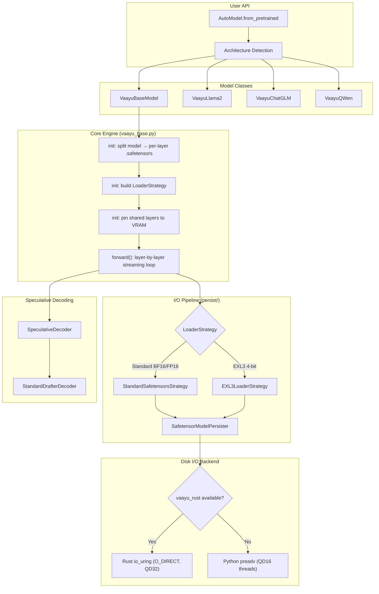
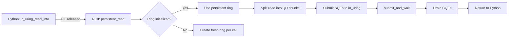
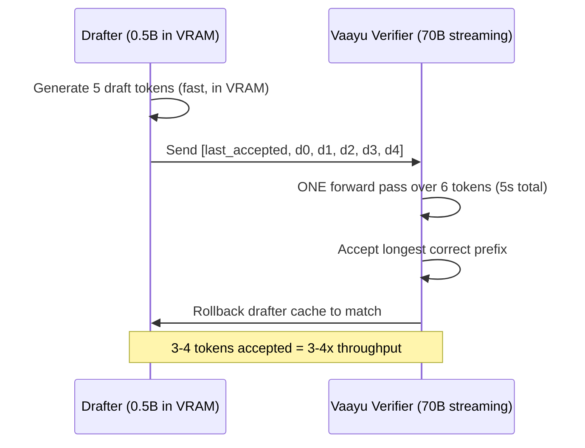

# 🌪️ Vaayu — Deep Codebase Analysis

## 1. What Is Vaayu?

Vaayu is a **layer-streaming LLM inference engine** designed to run models far larger than GPU VRAM by streaming model weights **layer-by-layer from NVMe SSD → CPU pinned RAM → GPU** on every single token. A 70B-parameter model (132 GB in BF16) runs on a single 16 GB GPU.

> [!IMPORTANT]
> The fundamental insight: GPU VRAM only needs to hold **one layer at a time** plus the KV cache, not the entire model. The NVMe-to-GPU bandwidth becomes the bottleneck, not VRAM capacity.

---

## 2. Architecture Overview



---

## 3. Data Flow: Per-Token Lifecycle

Every single token generated follows this exact sequence:

### 3.1 Forward Pass Loop ([vaayu_base.py:1083–1358](file:///home/a/code/ai-ml/Vaayu/vaayu/vaayu_base.py#L1083-L1358))

```
For each layer in [embed, layer.0, layer.1, ..., layer.N-1, norm, lm_head]:
  
  1. IS PINNED?  → skip disk load, already in VRAM
     
  2. NOT PINNED → 
     a. WAIT for prefetched tensor (ThreadPoolExecutor future)
     b. KICK OFF next non-pinned layer's disk read (overlap I/O with GPU transfer)
     c. INJECT tensors to GPU via LoaderStrategy.inject_to_gpu()
     
  3. EXECUTE layer forward pass on GPU
     
  4. FREE layer from GPU (move to "meta" device) — reclaim VRAM
     
  5. Every 40 layers: gc.collect() + torch.cuda.empty_cache()
```

### 3.2 Prefetching Pipeline

The engine uses a **producer-consumer double-buffered pipeline**:

| Stage | Overlaps With | Mechanism |
|-------|---------------|-----------|
| **Disk Read** (Layer N+1) | GPU Compute (Layer N) | `ThreadPoolExecutor` with 1 worker |
| **CPU→GPU Transfer** (Layer N) | Disk Read (Layer N+1) | `non_blocking=True` CUDA copy |
| **GPU Compute** (Layer N) | Disk Read (Layer N+1) | Normal CUDA execution |

---

## 4. I/O Pipeline Deep Dive

### 4.1 Pinned Memory Double-Buffer ([safetensor_model_persister.py:49–54](file:///home/a/code/ai-ml/Vaayu/vaayu/persist/safetensor_model_persister.py#L49-L54))

Two pre-allocated CUDA-pinned host buffers alternate:

```
Token 1: read into buf[0], process → read into buf[1] (next layer)
Token 2: read into buf[1], process → read into buf[0] (next layer)  
```

Buffers are allocated lazily and grow as needed (current layer size + 100 MB padding + 4096-byte O_DIRECT alignment).

### 4.2 Rust `io_uring` Engine ([vaayu_rust/src/lib.rs](file:///home/a/code/ai-ml/Vaayu/vaayu_rust/src/lib.rs))

The Rust extension provides kernel-bypass disk I/O:



**Key features:**
- **Persistent Ring**: Single `IoUring` instance (QD32) lives in a `static Mutex<Option<RingState>>` for the process lifetime
- **File Registration**: `IORING_REGISTER_FILES` pre-registers all `.safetensors` file descriptors — avoids `open()`/`close()` per layer read
- **O_DIRECT**: Bypasses Linux page cache entirely — reads go straight from NVMe controller to userspace pinned buffer
- **Chunk splitting**: Each read is split into `ceil(length / QD)` chunks, 4096-byte aligned, submitted as parallel SQEs
- **Buffer registration**: Attempted but permanently disabled for CUDA-pinned memory (kernel's `get_user_pages_fast()` returns EFAULT on NVIDIA-managed pages)

**Fallback path** (no Rust): Python `os.preadv()` with 16 threads, each reading a chunk of the file.

### 4.3 Safetensors Parsing ([safetensor_model_persister.py:96–188](file:///home/a/code/ai-ml/Vaayu/vaayu/persist/safetensor_model_persister.py#L96-L188))

```
1. Read 8-byte header length
2. Parse JSON header → get tensor names, shapes, dtypes, byte offsets
3. Compute aligned read range (O_DIRECT requires 4096-byte alignment)
4. Read entire data blob into pinned buffer via io_uring/preadv
5. Reconstruct tensors as zero-copy views into the pinned buffer
```

---

## 5. Model Splitting & Weight Management

### 5.1 Layer Splitting ([utils.py:183–391](file:///home/a/code/ai-ml/Vaayu/vaayu/utils.py#L183-L391))

On first load, Vaayu splits the original HuggingFace checkpoint into per-layer `.safetensors` files:

```
model-00001-of-00019.safetensors  →  splitted_model/
model-00002-of-00019.safetensors      ├── model.embed_tokens.safetensors
...                                    ├── model.layers.0.safetensors
                                       ├── model.layers.1.safetensors
                                       ├── ...
                                       ├── model.layers.79.safetensors
                                       ├── model.norm.safetensors
                                       └── lm_head.safetensors
```

Each file is atomically marked with a `.done` sentinel to survive interrupted splits.

### 5.2 LoaderStrategy Pattern ([loader_strategy.py](file:///home/a/code/ai-ml/Vaayu/vaayu/persist/loader_strategy.py))

| Strategy | Detection | load_from_disk | inject_to_gpu | free_from_gpu |
|----------|-----------|----------------|---------------|---------------|
| **StandardSafetensorsStrategy** | No EXL3 q-tensors in header | `load_layer()` → pinned/io_uring | `move_layer_to_device()` (standard PyTorch) | `layer.to("meta")` |
| **EXL3LoaderStrategy** | `trellis`/`suh`/`svh`/`mcg` in safetensors header | `load_layer()` + dtype correction | `make_q_matrix()` C++ call per linear | Explicit `bc = None` destructor + `to("meta")` |

Auto-detection happens via `_peek_safetensors_keys()` — reads only the first 8-byte header length + JSON header of `model.layers.0.safetensors`.

---

## 6. VRAM Management

### 6.1 Asymmetric Layer Pinning ([vaayu_base.py:722–797](file:///home/a/code/ai-ml/Vaayu/vaayu/vaayu_base.py#L722-L797))

Two-phase pinning strategy:

| Phase | Layers | On Budget Miss |
|-------|--------|----------------|
| **Phase 1** (shared) | `embed_tokens`, `norm`, `lm_head` | `continue` (try next) |
| **Phase 2** (transformer) | `layers.0`, `layers.1`, … | `break` (stop — homogeneous sizes) |

Budget = `total_VRAM - KV_cache_reservation - 1.5 GB overhead`

Example on 16 GB GPU with FP8 KV + EXL3: ~28 transformer layers pinned permanently (out of 80 for Llama-70B). These **never** hit NVMe, eliminating ~35% of all disk reads per token.

### 6.2 FP8 KV Cache ([vaayu_base.py:51–100](file:///home/a/code/ai-ml/Vaayu/vaayu/vaayu_base.py#L51-L100))

`FP8DynamicCache` stores K/V tensors in `torch.float8_e4m3fn` with per-head per-token scales:

```
KV footprint at 8k context:
  BF16: 80 × 2 × 8 × 128 × 8192 × 2 bytes = 2.68 GB
  FP8:  80 × 2 × 8 × 128 × 8192 × 1 byte  = 1.38 GB  (saves ~1.3 GB)
```

### 6.3 Chunked Prefill ([vaayu_base.py:1034–1081](file:///home/a/code/ai-ml/Vaayu/vaayu/vaayu_base.py#L1034-L1081))

Long prompts (>512 tokens) are split into chunks to prevent OOM during prefill:

```
4,000 token prompt → 8 chunks of 512 tokens
Each chunk does a full forward pass, accumulating KV cache
```

---

## 7. Speculative Decoding

### 7.1 Architecture ([speculative/](file:///home/a/code/ai-ml/Vaayu/vaayu/speculative))



### 7.2 Implementation

- **`StandardDrafterDecoder`**: Uses any small HuggingFace model (e.g. Qwen2.5-0.5B) permanently loaded in VRAM
- **Draft**: Autoregressive generation of N tokens using the small model
- **Verify**: Greedy comparison — accept longest prefix where `verifier_argmax == draft_token`
- **Bonus token**: If all drafts accepted, the verifier's extra logit provides a free additional token
- **Cache trim**: `_trim_kv_cache()` truncates both FP8 and standard caches in-place after rejection

---

## 8. Compatible Model Types

### 8.1 Architecture Auto-Detection ([auto_model.py:57–94](file:///home/a/code/ai-ml/Vaayu/vaayu/auto_model.py#L57-L94))

The `AutoModel.get_module_class()` maps HuggingFace `config.architectures[0]` to Vaayu classes:

| Architecture String | Vaayu Class | Notes |
|---------------------|-------------|-------|
| `LlamaForCausalLM` | `VaayuLlama2` | Primary target, uses BetterTransformer |
| `Qwen2ForCausalLM`, `Qwen2_5ForCausalLM`, `Qwen3ForCausalLM` | `VaayuBaseModel` | Modern Qwen uses standard layer names |
| `QWenLMHeadModel` (QWen v1) | `VaayuQWen` | Custom rotary/attention interface |
| `ChatGLMModel` | `VaayuChatGLM` | Custom layer names + rotary |
| `BaichuanForCausalLM` | `VaayuBaseModel` | Custom tokenizer (BaichuanTokenizer) |
| `InternLMForCausalLM` | `VaayuBaseModel` | Standard layer names |
| `MistralForCausalLM` | `VaayuBaseModel` | Standard layer names |
| `MixtralForCausalLM` | `VaayuBaseModel` | MoE detected automatically |
| `GemmaForCausalLM`, `Gemma2ForCausalLM` | `VaayuLlama2` | Same layer structure as Llama |
| **Any unknown architecture** | `VaayuBaseModel` | Falls back to auto-detect layer names |

### 8.2 Auto-Detection Fallback ([vaayu_base.py:115–145](file:///home/a/code/ai-ml/Vaayu/vaayu/vaayu_base.py#L115-L145))

For unknown architectures, `_auto_detect_layer_names()` scans the model tree for:

| Component | Searched Names | Type Check |
|-----------|---------------|------------|
| **Embedding** | `embed_tokens`, `word_embeddings`, `wte`, `embed`, `token_embeddings` | `nn.Embedding` |
| **Layer list** | Largest `nn.ModuleList` found in model | `nn.ModuleList` |
| **Final norm** | `norm`, `final_layernorm`, `ln_f`, `final_norm`, `layer_norm`, `ln_out` | Not Linear/Embedding/ModuleList |
| **LM head** | `lm_head`, `output_layer`, `embed_out`, `output`, `head` | `nn.Linear` |

### 8.3 Config Fallback Mappings ([vaayu_base.py:356–394](file:///home/a/code/ai-ml/Vaayu/vaayu/vaayu_base.py#L356-L394))

Vaayu maps non-standard config attributes to canonical names:

```
hidden_size      ← d_model, n_embd, n_emb
num_hidden_layers ← num_layers, n_layer, n_layers
num_attention_heads ← num_heads, n_head, n_heads
num_key_value_heads ← num_kv_heads, n_kv_head
intermediate_size ← ffn_dim, inner_dim
rms_norm_eps     ← layer_norm_eps, norm_eps
rope_theta       ← rotary_emb_base
hidden_act       ← activation_function
max_position_embeddings ← n_positions, max_seq_len, seq_length
```

### 8.4 MoE Support ([vaayu_base.py:636–665](file:///home/a/code/ai-ml/Vaayu/vaayu/vaayu_base.py#L636-L665))

Mixture-of-Experts models (Mixtral, DeepSeek-MoE, Qwen-MoE) are detected automatically via:
- `config.num_local_experts` or `config.num_experts`
- `"Moe"` / `"MoE"` / `"Mixtral"` in architecture string

> [!WARNING]
> Current MoE support streams the **entire MoE layer** (all experts) from disk on every token. Expert-aware selective streaming (Phase 3) is listed as pending — this means Mixtral/DeepSeek layers are ~8× larger than dense layers, significantly impacting throughput.

### 8.5 VLM Support ([vaayu_base.py:349–353](file:///home/a/code/ai-ml/Vaayu/vaayu/vaayu_base.py#L349-L353))

Vision-Language Models (e.g., Gemma4) are partially supported via:
- `config.text_config` unpacking — nested text model config gets promoted to top-level
- `_path_remappings` — handles architectures where layer paths differ from the standard `model.layers.X` prefix

---

## 9. Quantization Formats

| Format | Strategy | VRAM per Layer (70B) | Disk Throughput Impact |
|--------|----------|---------------------|----------------------|
| **BF16/FP16** (unquantized) | `StandardSafetensorsStrategy` | ~1.6 GB | Baseline — streams 132 GB/token |
| **EXL3 4.5 bpw** | `EXL3LoaderStrategy` | ~0.4 GB (QMatrix in C++) | ~3.5× smaller payload |
| **bitsandbytes 4-bit** | Standard + `HfQuantizer` | ~0.4 GB | Compressed on-disk, decompressed on load |
| **bitsandbytes 8-bit** | Standard + `HfQuantizer` | ~0.8 GB | 2× smaller than BF16 |

> [!TIP]
> **EXL3 is the recommended format** for Vaayu. It reduces the total streaming payload from 132 GB to ~37 GB for Llama-70B, directly cutting per-token latency by ~3.5×. The 4-bit CUDA kernels in ExLlamaV3 also run faster than dequantized BF16 matmuls.

---

## 10. Complete Compatible Model Matrix

### ✅ First-Class Support (Tested & Optimized)

| Model Family | Example Models | Format | Notes |
|-------------|---------------|--------|-------|
| **Llama 2/3/3.1/3.3** | Llama-3.3-70B-Instruct | BF16, EXL3 | Primary development target |
| **Qwen 2/2.5/3** | Qwen2.5-72B-Instruct, Qwen2.5-Coder-32B | BF16, EXL3 | Uses VaayuBaseModel directly |
| **Gemma / Gemma2** | Gemma-2-27B | BF16 | Same class as Llama |
| **Mistral** | Mistral-7B, Mistral-Large | BF16, EXL3 | Standard layer names |
| **Mixtral** (MoE) | Mixtral-8x7B, Mixtral-8x22B | BF16 | MoE auto-detected; full expert streaming |

### ✅ Supported (Auto-Detected)

| Model Family | Example Models | Notes |
|-------------|---------------|-------|
| **InternLM** | InternLM2-20B | Standard layer names |
| **Baichuan** | Baichuan-13B | Custom tokenizer auto-injected |
| **ChatGLM** | ChatGLM3-6B | Custom layer names + rotary handling |
| **QWen v1** | QWen-14B | Legacy attention interface |
| **DeepSeek** | DeepSeek-V2/V3 | MoE detected; standard layer names |
| **Phi** | Phi-3 | Auto-detected layer names |
| **CodeLlama** | CodeLlama-34B | Same as Llama |
| **Yi** | Yi-34B | Same as Llama |

### ⚠️ Partially Supported

| Model Family | Limitation |
|-------------|-----------|
| **VLMs** (Gemma4, LLaVA) | Text backbone works; vision encoder not streamed |
| **MoE models** (Mixtral, DeepSeek-MoE) | Full expert streaming (no expert-selective I/O yet) |

### ❌ Not Supported

| Type | Reason |
|------|--------|
| **Encoder-only** (BERT, RoBERTa) | No `CausalLM` head — Vaayu is decoder-only |
| **Encoder-Decoder** (T5, BART) | Cross-attention architecture incompatible with layer streaming |
| **GGUF format** | Vaayu reads safetensors only; would need a new `LoaderStrategy` |
| **GPTQ format** | Would need a `GPTQLoaderStrategy` (not implemented) |
| **AWQ format** | Same — would need a dedicated strategy |

### Drafter Models (for Speculative Decoding)

Any small HuggingFace `AutoModelForCausalLM` works. Recommended:

| Drafter | VRAM | Best For |
|---------|------|----------|
| Qwen2.5-0.5B | ~300 MB | General use, minimal VRAM impact |
| Qwen2.5-Coder-0.5B | ~300 MB | Code generation tasks |
| Qwen2.5-Coder-1.5B | ~1.0 GB | Higher acceptance rate for code |
| TinyLlama-1.1B | ~600 MB | Llama-family pairing |

> [!NOTE]
> The drafter does **not** need to share architecture with the verifier — only the tokenizer must be compatible. A Qwen-0.5B drafter can verify against a Llama-70B verifier if they share the same tokenizer (they don't by default, so pairing within families is recommended).

---

## 11. File-Level Reference

### Python Package (`vaayu/`)

| File | Lines | Purpose |
|------|-------|---------|
| [vaayu_base.py](file:///home/a/code/ai-ml/Vaayu/vaayu/vaayu_base.py) | 1462 | Core engine: init, forward loop, KV cache, pinning, speculative generate |
| [auto_model.py](file:///home/a/code/ai-ml/Vaayu/vaayu/auto_model.py) | 105 | Architecture detection + NVMe scheduler check |
| [utils.py](file:///home/a/code/ai-ml/Vaayu/vaayu/utils.py) | 462 | Model splitting, layer loading, memory cleanup |
| [vaayu.py](file:///home/a/code/ai-ml/Vaayu/vaayu/vaayu.py) | 14 | VaayuLlama2 (enables BetterTransformer) |
| [vaayu_qwen.py](file:///home/a/code/ai-ml/Vaayu/vaayu/vaayu_qwen.py) | 59 | QWen v1 legacy interface |
| [vaayu_chatglm.py](file:///home/a/code/ai-ml/Vaayu/vaayu/vaayu_chatglm.py) | 54 | ChatGLM custom layer names + rotary |
| [profiler.py](file:///home/a/code/ai-ml/Vaayu/vaayu/profiler.py) | 39 | Per-stage timing profiler |
| [persist/loader_strategy.py](file:///home/a/code/ai-ml/Vaayu/vaayu/persist/loader_strategy.py) | 488 | Strategy pattern: Standard vs EXL3 |
| [persist/safetensor_model_persister.py](file:///home/a/code/ai-ml/Vaayu/vaayu/persist/safetensor_model_persister.py) | 232 | Pinned memory loader, io_uring integration |
| [persist/model_persister.py](file:///home/a/code/ai-ml/Vaayu/vaayu/persist/model_persister.py) | 29 | Singleton persister factory |
| [speculative/standard.py](file:///home/a/code/ai-ml/Vaayu/vaayu/speculative/standard.py) | 85 | Standard drafter-verifier loop |
| [speculative/base.py](file:///home/a/code/ai-ml/Vaayu/vaayu/speculative/base.py) | 50 | Abstract speculative decoder interface |

### Rust Extension (`vaayu_rust/`)

| File | Lines | Purpose |
|------|-------|---------|
| [src/lib.rs](file:///home/a/code/ai-ml/Vaayu/vaayu_rust/src/lib.rs) | 451 | io_uring kernel-bypass I/O: persistent ring, file/buffer registration, read ops |
| [Cargo.toml](file:///home/a/code/ai-ml/Vaayu/vaayu_rust/Cargo.toml) | 18 | Dependencies: PyO3 0.21, io-uring 0.7, libc 0.2 |

### Python → Rust API

| Python Function | Rust Function | Purpose |
|----------------|---------------|---------|
| `vaayu_rust.init_ring(qd)` | `init_ring` | Create persistent io_uring ring |
| `vaayu_rust.register_files(paths)` | `register_files` | Pre-register file descriptors |
| `vaayu_rust.register_buffers(...)` | `register_buffers` | Register pinned memory buffers |
| `vaayu_rust.io_uring_read_into(path, offset, length, buf_ptr, qd)` | `io_uring_read_into` | Main read: persistent ring or legacy fallback |
| `vaayu_rust.pread_into(path, offset, length, buf_ptr)` | `pread_into` | Simple pread fallback (no io_uring) |
